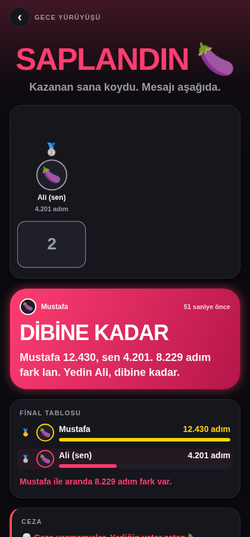
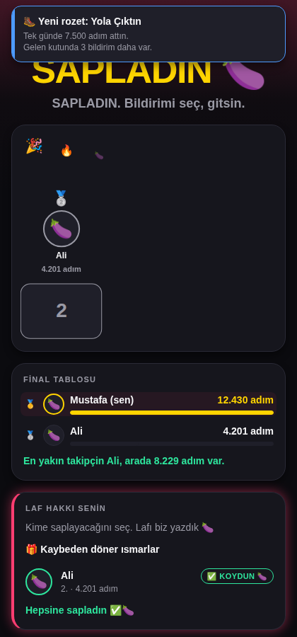
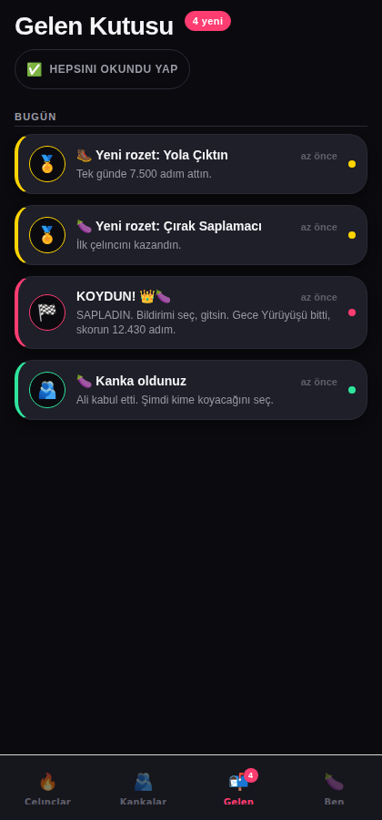

# KOYDUM 🍆

**Arkadaşına koy. Sapır sapır.**

Arkadaşlar arası "çelınc" uygulaması. Bir yarışma açarsın (3 günlük adım yarışı, bir haftalık
odak seansı, sabah 07:00'den önce kalkma...), herkesin skoru sayılır, süre bitince kazanan
**"KOYDUM MU?"** deme hakkını kazanır. Kaybedenlerin telefonuna bildirim düşer:

> **KOYDUM MU?**
> Mustafa sana sapır sapır sapladı 🍆 12.430 adım karşısında 4.201 adım. Yedin Ali.

Ödül kısmı bahane. Asıl mesele laf hakkı. Ve o laf hakkı insanı gerçekten yürütüyor.

Uygulama hem **iOS** hem **Android** için tek koddan çalışır (Expo / React Native).
Arkadaş grubunun kendi sunucusunu çalıştırması yeterli; ortada kayıt olunacak bir şirket yok.

<p align="center">
  
  
  
</p>

<p align="center"><i>Soldan sağa: rezillik ekranı, kazananın laf hakkı, gelen kutusu.
Bu görüntüler uçtan uca test çalışırken gerçek veriyle çekildi (<code>node e2e/smoke.mjs</code>).</i></p>

---

## İçindekiler

1. [Ne var içinde](#ne-var-içinde)
2. [Hızlı başlangıç (5 dakika)](#hızlı-başlangıç-5-dakika)
3. [Telefonda açmak](#telefonda-açmak)
4. [APK yapıp arkadaşına göndermek](#apk-yapıp-arkadaşına-göndermek)
5. [Sunucuyu internete açmak](#sunucuyu-internete-açmak)
6. [Yönetim komutları](#yönetim-komutları)
7. [Adamlık seviyeleri](#adamlık-seviyeleri)
8. [Çelınc türleri](#çelınc-türleri)
9. [Adım sayımı nasıl çalışıyor](#adım-sayımı-nasıl-çalışıyor)
10. [Proje yapısı](#proje-yapısı)
11. [Geliştirme komutları](#geliştirme-komutları)
12. [Sık karşılaşılan sorunlar](#sık-karşılaşılan-sorunlar)
13. [Testler](#testler)

---

## Ne var içinde

| Klasör | Ne işe yarar |
|---|---|
| `apps/mobile` | Telefon uygulaması. Expo SDK 57, expo-router, TypeScript. |
| `apps/server` | Sunucu. Fastify + SQLite. Tek dosyalık veritabanı, ORM yok. |
| `packages/shared` | İki tarafın da kullandığı tipler, doğrulama şemaları, puanlama, çelınc kataloğu, 104 laf sokma metni ve üç seviyelik arayüz metinleri. |
| `SPEC.md` | Teknik şartname. Veri modeli, API sözleşmesi, ekran listesi. Kod değiştirirken buraya bak. |
| `docs/ARCHITECTURE.md` | Kodun neden böyle bölündüğü: zaman/gün mantığı, çelıncın ömrü, puanlama, laf sokma zinciri. |

Gereksinimler: **Node 20 veya üstü** ve telefonunda **Expo Go** (ya da bir geliştirme derlemesi).

---

## Hızlı başlangıç (5 dakika)

```bash
# 1. Bağımlılıkları kur (bir kere, kökten)
npm install

# 2. Sunucuyu başlat
npm run server
# → 21:03:12 • KOYDUM sunucusu ayakta: port 4000, veritabanı data\koydum.db
```

Sunucunun penceresinde her satır saatiyle başlar: `•` olağan işler (çelınc bitti, bildirim
gitti, günün yedeği alındı), `!` bir uyarı (yavaş ya da patlayan bir istek, yeni bir şikayet),
`✗` bir hata. Gün dönünce araya tarih girer. Bir kanka "bildirim gelmedi" derse o saatin
satırlarına bak.

Sunucu ilk çalıştığında `apps/server/data/` altında SQLite veritabanını ve bir JWT anahtarı
üretir. Bir ayarı değiştirmek istersen (mesela portu), örnek dosyayı kopyalayıp Not Defteri'nde
aç:

```powershell
copy apps\server\.env.example apps\server\.env
notepad apps\server\.env
```

`npm run server`, `npm run internet`, `npm run yonet` ve `npm run apk:yayinla` bu dosyayı
açılırken okur; bir şey değiştirdiysen sunucuyu kapatıp aç. PowerShell'de elle verdiğin bir
değer (`$env:PORT=5000`) dosyadakinden önce gelir.

**Ayrı bir terminalde** uygulamayı başlat:

```bash
npm run mobile
# → QR kod çıkar
```

> `npm run server` kapanmaz, çalışmaya devam eder. İki komutu aynı pencereye yapıştırırsan
> ikincisi hiç çalışmaz. Windows'ta ikinci bir PowerShell penceresi aç, `cd` ile proje
> klasörüne gir, `npm run mobile`'ı orada çalıştır.

Expo Go ile deneyecekseniz, QR kodun üstünde `Using development build` yazıyorsa terminalde
**`s`** tuşuna basıp Expo Go moduna geç; QR kodu ondan sonra okut.

Telefonunla QR kodu okut. Uygulama kendiliğinden bilgisayarının IP adresini bulup sunucuya
bağlanmaya çalışır. Bağlanamazsa giriş ekranındaki **"Sunucu: ... · değiştir"** satırından
adresi elle yazabilirsin (aşağıya bak).

Kayıt ol, arkadaşını da kaydet, arkadaş ekleyin, çelınc açın. Hepsi bu.

---

## Telefonda açmak

### Aynı Wi-Fi ağındaysanız (en kolay yol)

Sunucu `0.0.0.0` üzerinde dinlediği için ağdaki her cihaz erişebilir. Bilgisayarının yerel IP
adresini bul:

```bash
# macOS
ipconfig getifaddr en0
# Linux
hostname -I | awk '{print $1}'
# Windows (PowerShell)
(Get-NetIPAddress -AddressFamily IPv4 | Where-Object {$_.InterfaceAlias -notmatch 'Loopback'}).IPAddress
```

Sunucunun penceresi de söyler: açılırken `şu adreste dinliyor: http://192.168.1.20:4000` gibi
satırlar yazar. `127.0.0.1` bilgisayarın kendisidir, telefonda işe yaramaz.

Çıkan adresi (`192.168.1.20` gibi) uygulamadaki **Sunucu adresi** ekranına yaz. Port yazmazsan
otomatik `:4000` eklenir. "Bağlantıyı test et" düğmesi yeşil yanıyorsa tamamdır. APK'yı yeni kurmuş
bir telefonda giriş ekranının en üstünde **Önce sunucuyu seç** kartı çıkar; adresi oraya da
yazabilirsin.

### Arkadaşların farklı ağdaysa: `npm run internet`

Sunucunun internetten erişilebilir olması gerekir. En kısa yol tek komut; ücretsiz, hesap
açmak ya da modemden port açmak gerekmiyor.

**Bir kere:** Cloudflare'in tünel programını kur. PowerShell'de:

```powershell
winget install --id Cloudflare.cloudflared
```

Kurduktan sonra PowerShell'i kapatıp yeniden aç.

**Her oynamak istediğinde**, `npm run server` yerine:

```powershell
cd C:\Users\ArisK\koydum
npm run internet
```

Birkaç saniye sonra ekranda şuna benzer bir satır çıkar:

```
✓ KOYDUM internette:  https://tatli-kelimeler-burada.trycloudflare.com
```

Bundan sonra uygulamada **Kankalar → Paylaş** bu adresle bağlantı gönderir. Başka şehirdeki
kankan bağlantıya dokunur, uygulama o adrese bağlanır, kayıt olunca kanka olursunuz. Senin telefonun
evdeki Wi-Fi'da kalabilir; aynı sunucudur.

Bilinmesi gerekenler:

* **Pencere açık kaldıkça çalışır.** Bilgisayar uyursa ya da pencereyi kapatırsan kankaların
  bağlanamaz, uygulamada "Sunucu şu an kapalı, uyuyor ya da adresi değişmiş" görürler; o arada
  girdikleri sayılar telefonda bekler. Bilgisayar uyandığında kendiliğinden gider. Pencereyi kapatıp
  yeniden açtıysan adres değişmiştir (aşağıda): bekleyenler kankan yeni bağlantıya dokunup **Yeni
  adrese geç**'e basınca gider, yeni bağlantıyı göndermeyi unutma. Çelınc sonuçları sunucu tekrar açılınca
  hesaplanır. Kapatırken **Ctrl+C**'ye bas: sunucu elindeki bildirimleri bitirip veritabanını
  düzgünce kapatır.
* **Bilgisayar uyumasın.** Sunucu penceresi açıkken (`npm run server` de `npm run internet` de)
  Windows bilgisayarı boşta kaldı diye uyutmaz; ekran kararır, sunucu çalışmaya devam eder.
  Dizüstünün kapağını kapatırsan ise yine uyur. Kapak kapalıyken de çalışsın istiyorsan:
  **Denetim Masası → Güç Seçenekleri → Kapağı kapatmanın yapacağı işlemi seçin → Prize
  takılıyken: Hiçbir şey yapma**. Pencerede "bilgisayarı uyanık tutamadım" yazıyorsa (okulun ya da
  işin kısıtladığı bir bilgisayar) **Ayarlar → Sistem → Güç**'te uykuyu **Hiçbir zaman** yap.
  Bilgisayar yine de uyursa adım ve ekran süresi çelınclarıyla itirazlar telafi edilir: uyanınca
  pencerede "bilgisayar 8 saat uyumuş" gibi bir satır çıkar. Uyurken biten bir adım ya da ekran
  süresi çelıncında kazanan, telefonlar bir saat daha beklendikten sonra belli olur, o saatte gelen
  sayılara itiraz da edilebilir; son saatinde elle giriş yapılmış bir çelınc da uyandıktan sonra bir
  saat itiraza açık kalır; uykudayken süresi dolan bir itirazın sahibi de fotoğraf eklemek
  için bir saat daha alır. Uyurken (ya da sunucu kapalıyken) basılan "Geldim" de basıldığı saatle
  sayılır: sunucu ne zaman uyuduğunu kendi yazar, telefon check-in'i sırada tutup uyanınca gönderir.
  Bunun için telefonun onu bilgisayar uyandıktan sonraki 12 saat içinde göndermesi lazım; kankanın
  uygulamayı bir kez açması yeter (pencereyi kapatıp açtıysan önce yeni bağlantıya geçmesi); uygulama
  zaten açıksa sunucu cevap verir vermez, en geç 15 saniyede kendisi gönderir. Hafta sonu kapalı
  kalan bilgisayarda cuma gecesinin check-in'i de böyle sayılır. Birkaç dakikalık
  kapanış da sayılır (`dur` ile `y` arası, çökme). Ama son gece elle yazılan sayılar, odak seansları ve uyurken biten
  bir check-in çelıncının son günü süre bittiyse reddedilir (uygulama hangi çelıncın hangi gününün
  gitmediğini söyler). Elle sayı ve odak çelınclarında bilgisayarın uyumaması şart. Bilgisayar
  uyandıktan ya da sunucu açıldıktan sonraki ilk 20 dakika günlük hatırlatma ve gün ortası dürtme
  gitmez: telefonlarda bekleyen girişler önce gelsin, sabah işaretleyen kankaya "hâlâ sıfırdasın"
  denmesin.
* **Sunucu çökerse pencere onu kendisi yeniden açar.** "Sunucu düştü, yeniden açıyorum" yazar,
  birkaç saniye sonra sunucu geri gelir. Tünel yerinde kaldığı için adres de aynıdır, kimseye
  yeni bağlantı atmana gerek yok. On dakikada beş kere çökerse de tüneli kapatmaz, adres yine
  aynı kalır: sebebi hemen üstündeki hatada yazar, pencere beş dakikada bir yeniden dener.
  Sebebi düzelttiysen (portu tutan öteki pencereyi kapattın, `npm install` yaptın) bekleme:
  pencerede `y` yazıp Enter'a bas.
* **Kodu güncellerken pencereyi kapatma.** `git pull` ve `npm install`'dan sonra bu pencerede `y`
  yazıp Enter'a bas: sunucu yeni kodla açılır, adres değişmez. Ayrıntısı
  [Sunucuyu güncellemek](#sunucuyu-güncellemek) bölümünde.
* **İnternet giderse tünel kopar, sunucu kapanmaz.** Pencerede "Tünel koptu (internet gitmiş
  olabilir), tekrar deniyorum" yazar. Evdeki Wi-Fi'dan bağlananlar oynamaya devam eder; pencere
  internet gelene kadar tüneli yeniden dener (en seyrek dakikada bir). Tünel geri gelince adres
  çoğu zaman değişir: pencerede yeni adres ve "Yeni adres: Kankalar > Paylaş ile gruba tekrar
  at." yazar, dediğini yap.
* **Açarken internet yoksa da sunucu açılır.** Pencerede "Tünel açılamadı" yazar (Cloudflare
  bazen bir süre tünel vermez, o zaman da böyle olur). Evdeki Wi-Fi'dan bağlananlar oynar, pencere
  de tüneli kendisi denemeye devam eder; `y` ile `dur` bu arada da çalışır. Tünel açılınca
  "KOYDUM internette" satırı adresle çıkar. Başka şehirdeki kankalara bağlantıyı ancak o zaman
  Paylaş'la gönder.
* **Pencereyi kapatıp açınca adres değişir.** Paylaş'la yeni bağlantıyı gönder. Kankan
  yeni bağlantıya dokununca uygulama "Bu davet yeni bir adresten" der; **Yeni adrese geç (çıkış
  yok)**'a basar, o kadar. Çıkış yapmaz, şifre yazmaz; hesabı, çelıncları ve bildirimleri
  yerindedir. Bağlantıyı başka yerden gören kankan **Ayarlar → Sunucu**'ya yeni adresi ya da
  bağlantının kendisini yapıştırır, aynısı olur. Uygulama adres değişse de aynı sunucu olduğunu
  anlar: yeni adres, oturumu taşımadan önce JWT anahtarını (`apps/server/data/secret`) bildiğini
  kanıtlamak zorundadır, kanıtlayamayan bir adrese oturum gitmez. O dosyayı silmedikçe kimse
  dışarı atılmaz.
* **Uygulaması eski sürüm (1.0) olan** kankanda bu ekran yok: bağlantıdaki **KOYDUM'da aç** ona
  boş bir sayfa açar. En kolayı aynı sayfadaki **Uygulamayı indir (Android)** ile yeni sürümü
  eskisinin üstüne kurması (hesabı kalır), sonra bağlantıya tekrar dokunup **Yeni adrese geç
  (çıkış yok)** demesi; bir daha da gerekmez. Kurmak istemezse eski uygulamada **Ayarlar →
  Sunucu → Çıkış yap ve değiştir** (ya da kırmızı **Adresi düzelt →** şeridi) der, sayfanın
  **Sunucu** satırındaki adresi başına `https://` koyarak yazar (`/davet/…` kısmı olmadan) ve
  aynı kullanıcı adı ve şifreyle girer.

Sabit bir adres ve 7/24 açık bir sunucu istersen aşağıdaki
[Sunucuyu internete açmak](#sunucuyu-internete-açmak) bölümüne bak.

### Expo Go'nun sınırları

Expo Go ile her şey çalışır, iki istisna dışında:

* **Android'de push bildirimi gelmez.** (Expo SDK 53'ten beri böyle.) Uygulama bunu biliyor:
  açıkken uygulama içi bildirim gösterir, kapalıyken arka plan görevi gelen kutusunu kontrol
  edip cihazın kendi bildirimini yaratır. Yani KOYDUM'u yine görürsün, sadece anında değil.
* **Health Connect okunamaz.** Android'de adımlar uygulama açıkken yaklaşık olarak sayılır.

İkisini de düzeltmek için bir geliştirme derlemesi al:

---

## APK yapıp arkadaşına göndermek

Evet, olur. İki ayrı iş var ve **asıl mesele ikincisi**.

### 1. APK

```bash
npm install -g eas-cli
eas login                       # ücretsiz Expo hesabı
cd apps/mobile
eas init                        # app.json'a extra.eas.projectId yazar (push için şart)
eas build --profile preview --platform android
```

Derleme Expo'nun sunucularında yapılır (ücretsiz kuyrukta 10-30 dakika sürebilir). Bitince bir
indirme bağlantısı verir: `.apk` dosyasını indir, WhatsApp'tan, Drive'dan, nereden istersen
gönder. Arkadaşın kurarken Android "bilinmeyen kaynak" uyarısı verir, bir kere izin vermesi
yeterli. Asıl vazgeçiren ondan sonraki uyarılar: arkadaşına "virüs mü bu" dedirtirler. Davet
sayfasındaki **Kurulmuyor mu?**'ya dokununca arkadaşın da şunları okur:

* Chrome "dosya zararlı olabilir" derse **Yine de indir**'e basar; her APK'da bunu der.
* Play Protect taramak isterse taratır, bir dakika sürer. "Engellendi" ya da "tanımıyor" derse
  **Ayrıntılar**'ı açıp **Yine de yükle**'ye basar.
* Telefon Xiaomi, Redmi ya da POCO'ysa kendi güvenlik taramasını yapar: bitmesini bekler, uyarı
  çıkarsa yine de kurmayı seçer.
* "Uygulama yüklenmedi" derse telefonda çoğu zaman başka yerden (Play dahili testinden ya da başka
  bir derlemeden) kurulmuş eski bir KOYDUM vardır: onu kaldırıp tekrar kurar. Hesabı sunucuda
  durur, kullanıcı adı ve şifresiyle girer.
* Kurduktan sonra Android 15 ve sonrası ekran süresi için gereken **Kullanım erişimi** anahtarını
  gri bırakıp "Kısıtlanmış ayar" diyebilir: anahtara bir kere dokunur, sonra Ayarlar → Uygulamalar
  → KOYDUM → sağ üstteki ⋮ → **Kısıtlanmış ayarlara izin ver**, ardından anahtarı yeniden açar
  (ayrıntısı [Ekran süresi nereden geliyor?](#ekran-süresi-nereden-geliyor) bölümünde).

`preview` profili bilerek **uygulama içi sunucu adresi ekranını açık bırakır** — arkadaşın
uygulamayı açtığında adresi kendisi yazabilir. Henüz sunucu seçilmemişse giriş ve kayıt ekranları
en üstte **Önce sunucuyu seç** der ve sunucu seçilene kadar giriş düğmesine basılamaz; arkadaşın
senin attığın davet mesajını olduğu gibi yapıştırır, sunucu da davet kodu da oradan okunur; giriş
ekranında yapıştırdıysa uygulama kendiliğinden kayıt ekranına geçer.
`production` profili adresi derlemeye gömer ve o ekranı gizler; onu kullanacaksan
`apps/mobile/eas.json` içindeki `EXPO_PUBLIC_KOYDUM_API_URL` değerini **önce kendi adresinle
değiştir**, yoksa açılmayan bir sunucuya bakan bir uygulama çıkar.

> **Düz HTTP hakkında:** Android 9'dan beri şifresiz `http://` bağlantıları varsayılan olarak
> engelli. Bu uygulama kendi sunucusuna bağlanmak zorunda ve o sunucu çoğu zaman ev ağındaki bir
> IP adresinde (`http://192.168.1.x:4000`) duruyor, o yüzden `app.json` içinde
> `usesCleartextTraffic: true` açık. Sunucunu gerçek bir alan adına ve HTTPS'e taşıdığında bunu
> kapatabilirsin.

> **iPhone:** Bir arkadaşının iPhone'una kurmak için Apple Developer hesabı ($99/yıl) ve
> TestFlight gerekiyor. Apple'ın kuralı, bunu aşmanın yolu yok. Android tarafında böyle bir
> engel yok.

### 1b. Güncellemeleri APK indirmeden almak (EAS Update)

Uygulamada `expo-updates` kurulu. Bunun anlamı: **JavaScript'e dokunan her düzeltme** (metin,
ekran, kural, rozet, laf) kurulu telefonlara **yeniden derlemeden** gider. Derleme yalnızca yerel
tarafa dokunan değişikliklerde gerekir (yeni bir native paket, `app.json`'daki izinler, ikon).

Bir düzeltmeyi yaymak için:

```bash
cd apps/mobile
eas update --channel preview --message "berabere metni düzeldi"
```

Bir dakika sürer. `preview` kanalındaki her kurulu uygulama (APK ya da Play iç testi) güncellemeyi
açılışta, bir de arka plandan öne her gelişinde (en fazla yarım saatte bir) arar ve bulursa arka
planda indirir. İndirme bitse de o an eski kodla çalışmayı sürdürür, ana ekranda sarı bir
güncelleme kartı çıkar. Arkadaşın **Yenile**'ye basarsa uygulama bir an kapanıp yeni hâliyle
açılır, **Sonra** derse uygulamayı tamamen kapatıp açtığında kendiliğinden güncellenir. Uygulama
kendi kendine yenilenmez: bildirimden açılan ekranı ya da süren bir odak seansını yarıda kesmesin
diye. Bu kart da bir güncellemeyle geldi; onu henüz almamış telefonlar güncellemeyi bulduktan
sonraki açılışta çalıştırır. Kanal, `eas.json`'daki profilde yazıyor; `play-internal` profili de
`preview` kanalını dinler, yani tek komut ikisine birden gider.

Hangi APK'nın hangi güncellemeyi alacağını `app.json`'daki `runtimeVersion` söyler, `version`
değil. `version` APK'nın sürümüdür (Ayarlar'ın en altında ve indirme sayfasında görünen) ve her
yeni APK'da yükselir. `runtimeVersion` şu an `"1.1.0"`: 1.1.0 ve 1.1.1 APK'ları aynı
`eas update`'i alır. 1.1.1'in getirdikleri telefonun yerel tarafında: ekran süresine ana ekranın
girmemesi ve manifestteki Health Connect arka plan izni. JavaScript o izni yalnızca sürümü 1.1.1
ya da üstü olan APK'da ister, 1.1.0'da hiç sormaz; aynı güncelleme 1.1.0'da da sorunsuz çalışır.
Böylece 1.1.1'i henüz kurmamış kankaların da düzeltmeleri almaya devam eder.

`runtimeVersion`'ı ancak JavaScript, eski APK'da olmayan yerel koda APK'nın sürümüne bakmadan
seslenmeye başladığında değiştir, o zaman da yeni APK'nın sürümüne çek
(`"runtimeVersion": "1.2.0"` gibi). Değiştirdiğin an eski APK'lar güncelleme almayı bırakır:
bekleyen düzeltmeleri önce eski numarayla `eas update` ile yayınla, sonra değiştir. Ekran
süresi modülü böyle bir değişiklikti: 1.1.0 yeni bir APK istedi, `eas update` 1.0.0 kurulumlarına
gitmedi.

Depoyu çekip (`git pull`) sunucuyu yeni kodla açtığında
([Sunucuyu güncellemek](#sunucuyu-güncellemek)) `apps/mobile` da değiştiyse `eas update`'i
aynı gün yayınla. Sunucu eski uygulamayla da çalışır, ama bazı düzeltmeler telefonda olur:
oturumu kapanan telefonun arka planda da çıkış yapması gibi. 1.1.0 kurulumları bunları ancak bu
güncellemeyle alır.

### 1c. Google Play'e gizli olarak koymak (dahili test)

Play'de "gizli uygulama" diye bir şey var, adı **Internal testing**. Mağazada listelenmez,
aramada çıkmaz; sadece senin eklediğin e-postalar (en fazla 100 kişi) ya da verdiğin bağlantıyla
kurulur ve **güncellemeler Play üzerinden** normal bir uygulama gibi gelir. Piyasaya çıkmadan
arkadaşlarla denemek için tam olarak bu.

Bir kerelik işler:

1. **Google Play Console** hesabı aç: [play.google.com/console](https://play.google.com/console) —
   25 $ tek seferlik ücret ve kimlik doğrulaması (birkaç gün sürebilir).
2. Console'da **Create app** → adı KOYDUM, uygulama, ücretsiz.
3. Derlemeyi mağaza formatında (AAB) al:
   ```bash
   cd apps/mobile
   eas build --profile play-internal --platform android
   ```
   Bu profil `preview` ile aynıdır, sadece APK yerine AAB üretir ve sürüm numarasını her seferinde
   otomatik artırır. Uygulama içi sunucu adresi ekranı açık kalır.
4. Console'da **Testing → Internal testing → Create new release**, indirdiğin `.aab` dosyasını
   yükle, kaydet, yayınla. İlk yüklemede Play imzalama anahtarını kendisinin yönetmesini kabul et.
5. Aynı sayfada **Testers** sekmesinden bir liste oluştur, arkadaşlarının Gmail adreslerini ekle.
   **Copy link** ile çıkan bağlantıyı onlara gönder; bağlantıya girip "Become a tester" deyince
   uygulama Play'de görünür ve kurulur.

Sonraki her sürümde sadece 3. ve 4. adım. (`eas submit -p android` ile 4. adımı da otomatiğe
bağlayabilirsin; bunun için Console'dan bir servis hesabı anahtarı gerekiyor, README'nin bu
kısmını ona göre genişletiriz.)

İki şey bilinsin:

* Google, yeni kişisel geliştirici hesaplarının **mağazaya (production) çıkmadan önce** en az 12
  kişiyle 14 gün kapalı test yapmasını istiyor. Dahili test için böyle bir şart yok — o hemen
  çalışır. Zaten sizin yapacağınız şey de bu.
* Play'den kurmak sunucu sorununu çözmez. Arkadaşların uygulamayı Play'den de alsa, uygulamanın
  konuşacağı bir KOYDUM sunucusu olmak zorunda — aşağıdaki bölüm.

### 1d. Davet bağlantısı ve APK'yı sunucudan dağıtmak

Kankalar sekmesindeki **Paylaş** artık bir bağlantı gönderir: `http://<sunucu>/davet/ABC123`.
Mesaj senin mesajın olduğu için senin seviyende yazılır: "Nazik"te "KOYDUM'da yarışalım mı? 🤝",
"Delikanlı"da "KOYDUM'da kanka olalım 🍆", "Ağır Abi"de bir de "bakalım kim kime saplıyor".
Arkadaşın bağlantıya dokununca sunucunun kendi sayfası açılır:

* "Mustafa seni KOYDUM'a çağırıyor" yazar (WhatsApp önizlemesinde de görünür); altındaki cümle de
  senin seviyende konuşur ("Nazik"te "kazanan belli olur, kaybeden rövanş ister", "Delikanlı"da
  "kazanan koyar, kaybeden yer", "Ağır Abi"de "kazanan saplar, kaybeden yer 🍆"),
* **KOYDUM'da aç** uygulamayı açar ve sunucu adresini uygulamaya kendisi verir; arkadaşın IP yazmaz,
* uygulama yoksa aynı sayfadan APK indirilir; Chrome, Play Protect ya da Xiaomi uyarı verirse
  sayfadaki **Kurulmuyor mu?** neye basılacağını söyler (yukarıdaki [1. bölümdeki](#1-apk)
  maddeler; sonuncusu kurulumdan sonra gri kalan **Kullanım erişimi** anahtarı için),
* kurulum bitince Android'in kendi **Aç** düğmesine basan arkadaşın uygulamayı bağlantısız açar;
  sayfadaki **Bağlantıyı kopyala** bunun için var. Uygulama giriş ekranında **Önce sunucuyu seç**
  der, arkadaşın kopyaladığı bağlantıyı (ya da WhatsApp mesajının tamamını) oraya yapıştırır;
  yapıştırınca uygulama kayıt ekranına geçer (hesabı olan altındaki **Giriş yap**'a basar).
  Bu kart 1.1.0 ile gelir; ondan önceki APK'da arkadaşın giriş ekranının
  altındaki **Sunucu: localhost:4000 · değiştir**'e basıp sadece adresi yazar (baştaki `https://`
  dahil, sondaki `/davet/…` kısmı olmadan; eski sürüm `https://` yazılmayan adresi `http://` sanar).
  Sayfa bunu kendisi ayarlar: `apk:yayinla` ile yayınlanan APK 1.1.0'dan eskiyse ya da sürümü
  bilinmiyorsa kopyalanacak kutuda bağlantı değil sadece adres durur ve bu yol yazar,
* kayıt olunca kanka olursunuz; senin **Kabul**'e basman gerekmez, yeni kankan hemen bir çelınc
  açabilir, sen de onu süren çelıncına çağırabilirsin. Oynadığın bir çelınc onu hâlâ alabiliyorsa
  "Yeni kanka" bildirimi o çelıncın adını söyler, dokununca da çelınc yeni kankan seçili olarak
  açılır (bkz. [Çelınc sürerken kanka ekleme](#çelınc-sürerken-kanka-ekleme)).

Davet bağlantısı senin "evet"inin yerine geçer: onunla gelen yeni hesap (bir haftadan genç)
sorulmadan kankan olur. Daha eski bir hesap bağlantıya dokunursa sadece istek gider, sen kabul
edersin. Arkadaşlıktan çıkardığın, isteğini reddettiğin ya da engellediğin biri de, hesabı ne kadar
yeni olursa olsun, bağlantıyla artık sadece istek gönderir; sen ona kendin istek atarsan ya da
isteğini kabul edersen bu kalkar. Bağlantı WhatsApp gruplarında elden ele geçer: tanımadığın biri
gelirse profilinden engelle. Engellemek davet bağlantını da yeniler: eskisiyle (yeni bir hesapla
bile) kimse gelemez, uygulama "Davet bağlantın da yenilendi" der. Henüz gelmemiş biri varsa ona
**Kankalar → Paylaş**'la yenisini at. Kodu tahmin etmeye kalkan da saatte 20 yanlış denemeden
sonra bekletilir.

APK'yı sunucuya koymak için expo.dev'den indirdiğin dosyayı bir kere yayınla:

```bash
npm run apk:yayinla -- C:\Users\sen\Downloads\koydum.apk
# sürümü APK'nın içinden okur; not eklemek istersen: -- dosya.apk --not "Ekran süresi geldi"
```

Sürümü `app.json`'dan değil, APK'nın kendisinden okur; telefon da kendi sürümünü oradan bilir.
Depodaki `app.json` çoğu zaman henüz derlemediğin bir sonraki sürümü yazar. 1.1.0 dosyası 1.1.1
diye yayınlanırsa 1.1.0'daki herkes "Yeni sürüm var" kartını görür, indirip kursa da kart gitmez.
İkisi farklıysa komut bunu bir satırla söyler ve APK'nın sürümüyle yayınlar. `--surum 1.1.0`
yazarsan ve APK başka bir sürümse hiçbir şeyi yayınlamadan durur: yanlış derlemeyi indirmiş
olabilirsin. Sürümü APK'dan okuyamazsa da durur; o zaman expo.dev'deki derleme sayfasında yazan
sürümü `--surum` ile sen ver.

Dosya `apps/server/data/app/koydum.apk` olarak durur, sunucu yeniden başlatmadan `/koydum.apk`
adresinden sunar. APK'yı başka yerde tutuyorsan (expo.dev derleme sayfası gibi) sunucuya
`APP_DOWNLOAD_URL` ve `APP_LATEST_VERSION` ortam değişkenlerini ver, sayfa oraya yönlendirir.

APK'nın boyu burada önemli: arkadaşların onu çoğu zaman mobil veriyle, senin evdeki internetinin
yükleme hızından indiriyor ve indirme sürerken sunucu herkese ağırlaşıyor. Bu yüzden `app.json`
derlemeye sadece telefonların kullandığı ARM kodunu koyuyor (bilgisayar emülatörlerinin x86 kodunu
koymuyor) ve yerel kütüphaneleri sıkıştırıyor. APK 113 MB'tan 42 MB civarına indi; küçülmüş hali
bir sonraki `eas build` ile gelir. Bilgisayardaki Android emülatöründe denemek istersen Android 11
ya da üstü bir sistem imajı seç, eskileri ARM kodunu çalıştıramadığı için APK'yı kurmaz.

İndirme yarıda kesilirse (tünel bir anlığına koptu, telefon ağ değiştirdi) baştan başlamaz:
arkadaşın Chrome'un indirilenler listesinde indirmeyi devam ettirince kaldığı yerden sürer. Arada
`apk:yayinla` ile yeni bir APK yayınladıysan yarım kalan eskinin üstüne eklenmez, yenisi baştan iner.

Yayınladığın sürüm telefondakinden yeniyse uygulamanın ana ekranında **"Yeni sürüm var"** kartı
çıkar ve İndir'e basınca APK iner. Böylece kimse hangi APK'da olduğunu tahmin etmek zorunda kalmaz.
Bu kart 1.1 sürümüyle geldi: 1.0'daki kankalar onu görmez, yenisini bir kereliğine davet
bağlantısındaki **Uygulamayı indir** ile ya da `…/koydum.apk` adresinden kurar.
APK'yla kuranlar yenisini üstüne kurar, hesapları kalır. Play dahili testinden kuranlara APK üstüne
kurulmaz (imza farklı); onlar Play'den günceller.

Giriş yapmış biri bağlantıya dokunursa uygulama önce kimin çağırdığını gösterir, istek ancak
**Kanka isteği gönder**'e basınca gider; hesabı bir haftadan gençse o dokunuşla kanka olursunuz.
Uygulamayı yeni kurmuş biri için sunucu adresi
bağlantıdan alınır; başka bir adrese bağlı olan birine ise geçmeden önce sorulur. Aynı sunucunun
yeni adresiyse (tünel yeniden açıldıysa) **Yeni adrese geç (çıkış yok)** çıkar ve oturum
yerinde kalır; gerçekten başka bir sunucuysa çıkış yapıp orada giriş yapmak gerekir.

> Bağlantının kimde açılacağı sunucunun nerede olduğuna bağlı. Sunucu evdeki bilgisayardaysa
> (`192.168.x.x`) bağlantı sadece aynı Wi-Fi'dakilerde açılır; uygulama bunu Kankalar sekmesinde
> söyler. Başka şehirdeki arkadaşlar için aşağıdaki tünel ya da kalıcı kurulum gerekir; tünel
> adresiyle açılan sayfa bağlantıları o adresten kurar.

### 2. Sunucu — asıl iş bu

APK tek başına yetmez: uygulama bir KOYDUM sunucusuna bağlanmak zorunda. Üç senaryo var:

| Durum | Ne yapman lazım |
|---|---|
| **Aynı evdesiniz / aynı Wi-Fi** | Hiçbir şey. Senin bilgisayarında `npm run server` açık olduğu sürece arkadaşın uygulamaya senin yerel IP'ni (`192.168.1.x:4000`) yazar ve oynarsınız. Bilgisayarı kapatınca oyun durur. |
| **Farklı yerdesiniz** | `npm run server` yerine `npm run internet` çalıştır (yukarıdaki [bölüm](#arkadaşların-farklı-ağdaysa-npm-run-internet)). Uygulamadaki Paylaş internet adresini kendisi kullanır. Bilgisayarın açık kaldığı sürece çalışır. |
| **Kalıcı olarak oynayacaksınız** | Sunucuyu bir yere kur. Depoda hazır `Dockerfile` ve `docker-compose.yml` var; en ucuz VPS'te (aylık birkaç dolar) ya da Fly.io / Railway gibi bir yerde çalışır. Aşağıdaki bölüme bak. |

Kalıcı kurulumda sunucu **7/24 açık kalmalı**: çelınclar bitince sonucu hesaplayan ve "KOYDUM"
bildirimini gönderen zamanlayıcı orada çalışıyor. Bilgisayar kapalıyken çelınc bitmez, biriken
işleri sunucu açılınca yapar.

### Bildirimler: gecikmeli (hazır) ve anlık (Firebase ile)

**Kurulumsuz hali zaten çalışıyor.** Uygulama arka planda aşağı yukarı 15 dakikada bir gelen
kutusuna bakar ve yeni gelen "KOYDUM MU?", dürtme ya da davet varsa telefonun kendi bildirimiyle
gösterir. Uygulama kapalı olsa da olur. Ayarlar'da bildirim satırı bu durumda **Gecikmeli** yazar.
Uygulama açıkken yeni bir bildirim gelince Gelen ve Kankalar sekmeleri kendiliğinden tazelenir,
aşağı çekip yenilemen gerekmez. Bildirime dokununca da okunmuş sayılır, rozetten düşer. Bir kanka
isteğini ya da çelınc davetini ana sayfadan, çelınc ekranından ya da Kankalar'dan cevaplarsan
Gelen'deki satırı da okunmuş sayılır; rozet cevapladığın istekleri saymaz. Güncellemeden önce
cevapladıkların da sunucu yeni sürümle ilk açıldığında okunmuş sayılır.
Android pili korumak için bu aralığı bazen uzatabilir. Telefonun bildirim ayarlarında hepsi
**KOYDUM** kanalında durur; onu kapatan lafları da kaçırır. Eski sürümden kalma bir
"Miscellaneous" kanalı görürsen ona artık bir şey gönderilmiyor.

**Laflar saatler sonra geliyorsa** (en çok Xiaomi ve Samsung'da olur) telefon KOYDUM'u pil için
bekletiyordur. Uygulamada **Ayarlar → Arka plan**'a gir:

* **Pil kısıtlaması** "Var" diyorsa **Kısıtlamayı kaldır**'a bas, Android'in açtığı pencerede izin ver.
* **Tam saatinde hatırlatma** "Kapalı" diyorsa **Alarm izni ver**'e bas, açılan sayfada KOYDUM'un
  anahtarını aç. Bu izin olmadan telefon check-in uyarısını kaydırabilir, 06:30'daki uyarı 07:00'yi
  geçebilir. Android 14 ve üstünde bu izin kapalı gelir.
* Xiaomi'de (Redmi ve POCO da) bir de telefonun **Ayarlar → Uygulamalar → KOYDUM → Otomatik
  başlatma** anahtarını aç; uygulama bunu da orada yazar.

Firebase'siz derlemede pil kısıtlaması açıksa ana sayfa bunu bir kere hatırlatır. Bu bölüm yerel
kod istediği için yeni APK ile gelir; eski APK'da Ayarlar'da hiç görünmez.

Gün ortası dürtme kişi başına günde en fazla bir kere gelir: birkaç çelıncta birden geride
kalan, en çok geride olduğu çelıncı duyar, gerisi aynı bildirimde sayılır ("2 çelıncta daha
gerideysin"). Dürtme, önündekilerden arana engel girmemiş en iyisini söyler; önündekilerin
hepsiyle aranda engel varsa yine gelir ama isim vermez ("Bir rakibin sana 9 bardak fark koymuş").
Evet/hayır çelıncında o günü işaretlediysen, cevabın ne olursa olsun, o çelınc için dürtme gelmez;
o gün yapacağın bir şey kalmadı. Sayı girilen çelıncta bugün bir şey girdiysen "girişini unutma"
demez, "biraz daha" ister; günlük sınırı doldurduysan o çelınc için hiç gelmez. Odak çelıncında
bugünün 360 dakikasını doldurduysan da gelmez.

**Günlük hatırlatma** Ayarlar'da seçtiğin saatte gelir, o gün elle hiçbir şey girmediysen ve hâlâ
boş bir çelıncın varsa. Telefonun kendiliğinden gönderdiği adım ya da ekran süresi onu susturmaz:
adımların gitti ama Şekersiz Günler'i işaretlemediysen hatırlatma o çelıncın adını söyler, dokununca
onu açar. Adımlarını telefonun zaten gönderdiği adım yarışı için ayrıca hatırlatmaz.

Bazı bildirimler fazla geliyorsa kanalı kapatma, uygulamada **Ayarlar → Bildirim tercihleri**'ne
gir: gün ortası dürtmeyi ("sana fark koymuş"), pazar akşamı haftalık özeti ve telefonun kendi
kurduğu saatli uyarıları (check-in'e yarım saat kala, çelıncın son saati, adım çelıncı bittikten
iki dakika sonra) ayrı ayrı kapatabilirsin.
Saatli uyarılar ayarı sadece o telefonda geçerli. Check-in uyarısı sadece katıldığın çelınclarda,
çelınc sürdüğü günlerde ve o gün daha "Geldim" demediysen çalar; çelınc bitince ya da iptal olunca
kendiliğinden susar. İleri bir tarihe açtığın çelıncı senden başka kimse kabul etmediyse o daha
başlamamıştır: ne check-in ne de son saat uyarısı çalar. Telefon bu uyarıları ikinci kişi kabul
ettikten sonraki ilk yenilemede kurar (uygulamayı açınca ya da arka planda kendini yenileyince).
"KOYDUM MU?" lafları, kankanın elle dürtmesi, davetler ve sonuçlar her zaman gelir.

**Anlık olsun istersen** (laf atıldığı saniye telefon titresin), Android'e Google'ın push servisi
(Firebase Cloud Messaging) gerekir. Bir kerelik iş, ücretsiz:

1. [console.firebase.google.com](https://console.firebase.google.com) → **Proje ekle** → adı KOYDUM, Analytics'i kapatabilirsin.
2. Projede **Android uygulaması ekle** → paket adı `com.koydum.app` → **google-services.json**'ı indir.
3. Dosyayı `apps/mobile/google-services.json` olarak koy ve `apps/mobile/app.json` içinde `"android": {` satırının hemen altına şunu ekle:
   ```json
   "googleServicesFile": "./google-services.json",
   ```
4. Firebase'de **Proje ayarları → Hizmet hesapları → Yeni özel anahtar oluştur** → bir JSON iner. Bu dosya gizli, kimseyle paylaşma, git'e koyma.
5. Bilgisayarda:
   ```powershell
   cd C:\Users\ArisK\koydum\apps\mobile
   eas credentials
   ```
   Android → preview → **Google Service Account** → **Push Notifications (FCM V1)** → 4. adımdaki JSON'u seç.
6. `google-services.json`'ı commit'le (bu dosya gizli değil, Google da öyle diyor) ve yeni APK derle.

Yeni APK'da Ayarlar'daki bildirim satırı **Açık** olur. `eas init` yapılmamışsa (`extra.eas.projectId`
yoksa) push token hiç alınamaz; bu depoda zaten yapılmış durumda.

Firebase'i sonradan açmak telefonlara eski bildirim yağdırmaz: sunucu anlık olarak sadece telefon
kaydolduktan sonra gelen, okunmamış ve bir saatten eski olmayan bildirimleri gönderir. Gerisi Gelen'de
durur. Bir telefon da tek hesaba bağlıdır: aynı telefonda başka biri kendi hesabına girerse
bildirimler artık ona gider, öncekinin lafları o telefonda çalmaz.

**Haftanın hesabı:** her pazar akşamı 20:00'den sonra herkese haftanın özeti düşer: kaç kere
koydun, kaç kere yedin, toplam adım ve kankalar arasında haftanın kralı. Sunucu pazar akşamı
kapalıysa pazartesi sabahı 07:00 ile 12:00 arasında yine gönderilir, gece gönderilmez: yurt
dışındaki bir kankanın pazar akşamı senin bilgisayarının uyuduğu saate denk gelebilir (New York'ta
pazar 20:00, İstanbul'da pazartesi 04:00), telafi özeti onu gece uyandırmasın. Gelen kutusunda kart
olarak görünür, dokununca profildeki sıralamaya gider.

**Laf sokmayı unutan kazanan:** çelınc bittikten 2 saat sonra kazanan kaybedenlerden birine
hâlâ laf sokmadıysa ona bir kere "Koymayacak mısın? Veli ağzını açmanı bekliyor." düşer,
dokununca sonuç ekranı açılır. Gece gitmez: kazananın saatiyle 12:00–22:00 arasında gelir, yani
gece yarısı biten çelıncın hatırlatması ertesi öğlen gelir. İki gün geçtiyse hiç gitmez.
Kazananın adına otomatik laf atılmaz. Kaybeden taraf bir gün boyunca laf gelmezse sonuç
ekranında "unuttu galiba, rövanş aç" yazısını görür; rövanş zaten açıldıysa yazı ona gösterir
("Rövanşı aşağıda"), berabere biten çelıncın satırları da öyle.

**Cevap hakkı ve beraberlik:** kazanan sana laf soktuysa sonuç ekranında lafın hemen altında
**Cevap ver** durur. Bir kere ve sadece kazanana cevap verebilirsin ("Yedim, kabul Ali. Rövanşta
o lafı sana yediririm lan."); kazanan da cevabını kendi sonuç ekranında, senin adının altında
görür. Kazanan hâlâ 1.0 kullanıyorsa cevabı sadece bildirim olarak görür, sonuç ekranında görmesi
için 1.1'i kurması gerekir. 1.0'ın gelen kutusu bu mesajların başına kazananın (beraberlikte
çelıncın) adını koyar; kimin yazdığını başlık söyler ("Veli cevap verdi", "Ali laf attı"). Berabere biten çelıncta birinciliği paylaşanlar birbirine birer laf atabilir (**Laf at**),
arkadan gelenler atamaz. Arkadan gelen için o çelınc berabere değil, yenilgidir: bildirimi "Ali ve
Veli berabere kaldı, sen 3. oldun. Ceza sende: Kaybeden bulaşık yıkar." der (ceza yazılmadıysa "Yine
de yedin"), profildeki Karne'de **Yedim**'e yazılır, ceza da ondadır.
Sonuç hâlâ bekleniyorsa (bitişten sonraki bir saat, itiraz)
kimse konuşamaz, sonuç yazılınca açılır.

**Rövanş ve seri lafları:** rövanşı kazandığında laf seçicide, ilk çelıncta seni geçmiş her
kankan için **RÖVANŞ** lafları çıkar. Geçen sefer de yendiğin, seninle berabere kalan ya da rövanşa
sonradan eklenen kankaya normal laflar gider. Profildeki rövanş rozetleri (🔁 Faiziyle Aldı ve üstü)
de sadece ilkini kaybettiğin çelıncların rövanşlarını sayar; kazandığın bir çelıncın rövanşını yine
kazanmak rövanş sayılmaz, önceden verilmiş rozet ise kalır. Rövanş daveti de kime gittiğine bakar:
"Ağır Abi" seviyesinde "Yine mi yiyeceksin bakalım" sadece ilkini kaybedene gider, kazanana "Geçen
sefer yedi, doymamış 🍆 Bir daha koy." yazar. Aynı kankayı üst üste üçüncü kez yenersen **SERİ**
lafları çıkar; arada bir beraberlik ya da kayıp seriyi bozar. Rövanş sadece hâlâ kankan olanları çağırır, grup çelıncında
başkası üzerinden tanıştığın biri gelmez. Sonuç ekranı bunu rövanş düğmesinin altında söyler;
final tablosunda adına dokunup profilinden ekleyebilirsin. Rövanş eskisi kaç gün sürdüyse o kadar
gün sürer ve açanın saatiyle gece yarısı biter. Saatli check-in'de bugünün saati geçtikten sonra
açılan rövanş, sihirbazdaki **Yarın** gibi ertesi gün başlar (Erken Kalkan Koyar 04:00'te, Erken
Yatma Sözü 09:00'da), ilk günü boşa gitmez. O saatte başlayan rövanş başka şehirdeki bir kankaya
daha az check-in günü bırakacaksa (İstanbul'da öğlen açılan Erken Yatma Sözü New York'ta son akşamdan
önce biter) rövanş senin saatinle gece yarısı başlar, o kanka da çağrılır. Reddedilen bir rövanş iptal olur ama yenisini
açmana engel olmaz. Bir çelıncın içinde olduğun rövanşı bir tane olur: kankan senden önce
açtıysa düğme **Rövanş daveti sende** der ve seni o rövanşa götürür (içindeysen **Rövanşa git**,
bittiyse **Rövanşın sonucu**). İkiniz aynı anda bassanız bile ikinci rövanş açılmaz, uygulama
seni açılmış olana götürür. Reddettiğin, içinden çıktığın (kendi açtığın da olsa) ya da artık
katılamayacağın (kapısı kapanmış, sen cevap vermeden bitmiş) bir rövanş sayılmaz, istersen
kendininkini açarsın. Açanın kankası olmadığın için çağrılmadığın bir rövanş da sayılmaz: grup
çelıncında kendininkini açarsın, ikinizin ortak kankası da iki rövanş daveti alır. Davet
edilecek kanka kalmadıysa düğme sönük durur.

**Sonucu WhatsApp grubuna atmak:** sonuç ekranında, rövanş düğmesinin altında **Gruba at** durur
(seviyene göre "Sonucu paylaş" ya da "Gruba at, herkes görsün" yazar). Dokununca telefonun paylaş
menüsü açılır, grubu seçersin. Giden mesajda kürsü yazı olarak durur (`🥇 Ali · 15.000 adım`),
altında senin seviyende bir cümle ve senin davet bağlantın olur: uygulaması olmayan dokunup kurar,
kayıt olunca da kankan olur. Sunucu `npm run server` ile sadece evde açıksa bağlantı
mesaja girmez, o adres zaten sadece aynı Wi-Fi'da açılır; `npm run internet` açıkken girer.
Mesajda sonuç ekranında görünenden fazlası yok: yarışanların adı ve skoru. Bilgisayardaki
tarayıcıda paylaş menüsü yerine mesaj panoya kopyalanır.

---

## Sunucuyu internete açmak

### Docker (en kısa yol)

```bash
docker compose up -d --build
```

Veriler `koydum-data` adlı bir volume'de durur. `PUBLIC_URL` ortam değişkenini dışarıdan
erişilen adrese ayarla, yoksa yüklenen kanıt fotoğraflarının bağlantıları yanlış olur:

```bash
PUBLIC_URL=https://koydum.example.com docker compose up -d
```

### Sunucusuz bir VPS'te

```bash
git clone <bu-depo> && cd koydum
npm ci
PUBLIC_URL=https://koydum.example.com \
DATA_DIR=/var/lib/koydum \
npm start -w apps/server
```

Önüne nginx/Caddy koyup HTTPS ver. Tek dosyalık SQLite veritabanı `DATA_DIR` altında.

**Yedek kendiliğinden alınır:** her gün bir tane, `DATA_DIR/backups` altına. Geri yüklemek ve
yedeklerin bilgisayar bozulsa da kalması için [Yedekler](#yedekler)'e bak.

### Ortam değişkenleri

Hepsi `apps/server/.env` dosyasına da yazılabilir ([Hızlı başlangıç](#hızlı-başlangıç-5-dakika)).
Ortamda aynı isimde bir değişken varsa (Docker, PowerShell'de `$env:...`) o kazanır.
Docker'da bu dosya okunmaz (imaja hiç girmez): orada ayarları `docker-compose.yml` içindeki
`environment:` altına ekle (ör. `APP_DOWNLOAD_URL: ${APP_DOWNLOAD_URL:-}`).

| Değişken | Varsayılan | Açıklama |
|---|---|---|
| `PORT` | `4000` | Dinlenen port |
| `HOST` | `0.0.0.0` | Yerel ağdan erişim için böyle bırak |
| `DATA_DIR` | `./data` | SQLite veritabanı ve JWT anahtarı |
| `UPLOAD_DIR` | `<DATA_DIR>/uploads` | Kanıt fotoğrafları |
| `UPLOAD_MIN_FREE_MB` | `2048` | Fotoğraf klasörünün diskinde bundan az boş yer (MB) kalınca sunucu kanıt fotoğrafı almaz; kalan yer veritabanına, adımlara ve yedeğe lazım ([Sık karşılaşılan sorunlar](#sık-karşılaşılan-sorunlar)). |
| `BACKUP_DIR` | boş | Günlük yedeklerin ikinci kopyası buraya da gider. OneDrive ya da Google Drive'daki bir klasörü yaz, PC bozulsa da yedekler kalır ([Yedekler](#yedekler)). |
| `PUBLIC_URL` | boş | Sunucunun internetteki adresi. Boşsa davet sayfası bağlantıları gelen isteğin adresinden kurar, evde de tünelde de doğru çıkar. |
| `JWT_SECRET` | otomatik üretilir | Elle vermek istersen |
| `LOG_LEVEL` | `info` | Sunucu penceresine ne yazılsın. Her istek tek tek yazılmaz; açılış, hatalar, 2 saniyeden uzun süren istekler ve zamanlayıcının yaptıkları saatiyle, Türkçe birer satır olarak görünür. `warn` sadece sorunları gösterir. |
| `LOG_FORMAT` | boş | Boşken pencerede Türkçe satırlar çıkar, çıktı dosyaya ya da Docker'a gidiyorsa JSON. `json` yazarsan pencerede de ham JSON çıkar (bir log aracına vereceksen). |
| `EXPO_ACCESS_TOKEN` | boş | Expo push için isteğe bağlı |
| `KEEP_AWAKE` | açık | Windows'ta sunucu açıkken bilgisayar boşta kaldı diye uyumaz (ekran yine kararır). `0` yazarsan kapanır; o zaman uykuyu Windows'un güç ayarlarından kapat ([Bilgisayar uyumasın](#arkadaşların-farklı-ağdaysa-npm-run-internet)). |
| `ENABLE_DEV_ROUTES` | `0` | `1` yaparsan test uçları açılır (üretimde açma) |
| `APP_DIR` | `<DATA_DIR>/app` | `npm run apk:yayinla`'nın APK'yı koyduğu yer |
| `APP_DOWNLOAD_URL` / `APP_LATEST_VERSION` | boş | APK başka yerdeyse bağlantısı ve sürümü |
| `TRUST_PROXY` | `loopback` | Hangi aradaki sunucunun `X-Forwarded-For` başlığına güvenileceği. Varsayılan sadece aynı bilgisayardaki tünel ya da vekil (cloudflared, nginx, Caddy); doğrudan bağlanan bir telefon kendi IP'sini seçemez. `0` hiç kimseye güvenmez; vekil başka makinedeyse adresini ya da ağını yaz (`10.0.0.0/8`). |

---

## Yönetim komutları

Sunucuyu açan sensin, hesapların anahtarı da sende. Birkaç iş için tek komut var. Sunucu açıkken de
çalışır (`geri-yukle` hariç); ikinci bir PowerShell penceresi aç, depo klasöründe çalıştır:

```powershell
cd C:\Users\ArisK\koydum
npm run yonet -- kullanicilar     # herkes: ne zaman katıldı, en son ne zaman girdi, kaç çelıncı sürüyor
npm run yonet -- sikayetler       # gelen şikayetler, en yenisi en üstte
npm run yonet -- sifre ali        # şifresini unutan ali'ye yeni şifre
npm run yonet -- sil ali          # ali'nin hesabını kapatır (önce sorar, geri alınamaz)
npm run yonet -- yedekler         # günlük yedekler: hangileri var, nerede duruyorlar
npm run yonet -- geri-yukle       # en yeni yedeği geri yükler (önce sunucuyu durdur)
```

Hep depo klasöründen `npm run yonet` ile çalıştır. Sunucunun kullandığı veritabanını
(`apps/server/data/koydum.db`) böyle bulur; bulamazsa bir şeye dokunmadan söyler.

**Kanka şifresini unuttu.** E-posta yok, "şifremi unuttum" bağlantısı da yok; giriş ekranı ona
sunucuyu açana, yani sana yazmasını söyler. `npm run yonet -- sifre ali` yeni bir şifre üretip
ekrana yazar (`uemjz5kk` gibi; birbirine benzeyen harf ve rakam yok). WhatsApp'tan gönder, o
şifreyle girsin. Hesabı, kankaları, rozetleri ve süren çelıncları yerinde kalır. Girdikten sonra
**Ayarlar → Hesap → Şifreni değiştir**'den kendi şifresini koyabilir; "123456" ile kaydolanlar da
oradan değiştirir. Bu düğme yeni sürümde (1.1); 1.0'daki kanka önce güncellemeli, yoksa senin
verdiğin şifreyle kalır.

* Kullanıcı adını hatırlamıyorsa önce `npm run yonet -- kullanicilar` ile bak.
* Türkçe harfle yazsan da bulur: `npm run yonet -- sifre Şeyma` hesabı `seyma` diye arar.
  Kullanıcı adlarında Türkçe harf olmaz, uygulama kayıtta ş'yi s'ye, ı'yı i'ye çevirir.
* Şifre sıfırlamak o hesabın bütün açık oturumlarını kapatır; kanka yeni şifreyle bir daha girer.
  Ayarlar'dan kendi şifresini değiştirince de öteki telefonlardaki oturumları kapanır, değiştirdiği
  telefondaki oturumu açık kalır. Hesabı bir kankanın telefonunda açık kaldıysa şifresini
  değiştirmesi yeter; bildirimler de o telefona gitmez artık, değiştirdiği telefona gelmeye devam
  eder. (Güncellemeyi almamış 1.1.0 uygulama hangi telefonun bildirim aldığını söylemez; orada
  bildirim, en son hangi telefon kaydolduysa onda kalır.)
* Çok yanlış deneme yaptıysa uygulama "Çok fazla deneme yaptın" der; yazdığı süre kadar beklesin.
* Bir hesaba bir saat içinde 30 yanlış şifre denenirse, nereden gelirse gelsin, o hesaba girişler
  bir saate kadar kapanır; uygulama "Bu hesaba çok fazla yanlış şifre denendi" der. O hesapla zaten
  girmiş telefonlar bir şey fark etmez. Kanka beklemek istemezse `npm run yonet -- sifre ali` ile
  yeni şifre ver, onunla hemen girer. Kendisi o kadar denemediyse biri şifresini tahmin etmeye
  çalışıyordur; yeni şifre onu da boşa çıkarır.

**Şikayetler.** Uygulamada biri birini şikayet edince sunucu penceresine `YENİ ŞİKAYET` diye bir
satır düşer, `npm run yonet -- sikayetler` de en yeni 200 şikayeti listeler (daha fazlası varsa
toplam kaç tane olduğunu altına yazar). Gerisi sana kalmış: konuşursunuz, gerekirse engellemesini
söylersin. Bir hesap saatte en fazla 10 şikayet gönderebilir, fazlasına uygulama "Çok fazla şikayet
gönderdin" der. Aynı kişiyi bir gün içinde aynı sebeple yeniden şikayet ederse (iki kez dokunmak
gibi) uygulama yine "alındı" der ama sana yeni bir satır gelmez; yeni bir sebep yeni bir satırdır. Böylece kimse pencereni şikayetle doldurup tünel adresini ve gerçek
hataları ekrandan kaydıramaz. Sebebin içindeki satır sonları ve PowerShell'de ekranı silen ya da
yazıyı gizleyen kaçış kodları atılır: liste hep düz yazı çıkar. Tanımadığın biri girdiyse
`npm run yonet -- sil <kullanici>` ile hesabını kapat.

**Hesap kapatmak.** `npm run yonet -- sil ali` önce "Ali (@ali) silinsin mi?" diye sorar, `evet`
yazarsan kapatır. Uygulamadaki **Hesabı sil** ne yapıyorsa o olur: telefonundaki oturum hemen
düşer, o hesapla bir daha giremez, süren çelınclarından çıkar (iki kişilikse çelınc iptal olur),
kanıt fotoğrafları ve notları silinir. Biten çelınclardaki skoru sonuçlar bozulmasın diye "Silinen
kanka" adıyla kalır. Süresi bitip sonucu henüz çıkmamış bir çelınc (bitişten sonraki bir saat,
süren bir itiraz) onu bırakmaz; oradaki fotoğrafı ve notu sonuç çıkana kadar kalır, sonuç çıkınca
sunucu onları da siler. Bu sürümden önce silinmiş hesapların kalan fotoğraf ve notlarını da
güncellemeden sonraki ilk açılışta siler. Telefonu "Bu hesap kapatıldı" der. Geri alınamaz. Bir betikten
çalıştırıyorsan soracak kimse olmadığı için sonuna `--evet` ekle:
`npm run yonet -- sil ali --evet`. Davet bağlantısı elinde olan biri yeniden kaydolabilir;
bağlantıyı nerelere attığına dikkat et.

Docker'da çalıştırıyorsan komutun başına `docker compose exec koydum` ekle:
`docker compose exec koydum npm run yonet -- sifre ali`. VPS'te sunucuyu `DATA_DIR` ile
açtıysan komuta da aynısını ver: `DATA_DIR=/var/lib/koydum npm run yonet -- sifre ali`.

### Sunucuyu güncellemek

Depoya yeni bir şey geldiğinde `npm run internet` penceresini kapatma: pencere kapanınca tünel
de gider, açınca adres değişir ve herkese yeni bağlantı atman gerekir. Pencere açık kalsın:

1. İkinci bir PowerShell penceresi aç, depo klasöründe:

   ```powershell
   cd C:\Users\ArisK\koydum
   git pull
   npm install
   ```

2. `npm run internet` penceresine geç, `y` yazıp Enter'a bas. "Sunucu yeni kodla yeniden
   açılıyor, adres aynı" yazar, birkaç saniye sonra sunucu yeni kodla geri gelir. Kimseye
   bağlantı atmana gerek yok, kankaların bir şey yapmaz.

`npm install` `EPERM` ya da `EBUSY` diye hata verirse açık sunucunun kullandığı bir dosyayı
değiştiremiyordur (Windows'ta veritabanı modülü olur). `npm run internet` penceresinde `dur`
yazıp Enter'a bas, "Sunucu durdu" yazınca `npm install`'ı tekrar çalıştır, bitince yine o
pencerede `y` ve Enter. Sunucu dururken tünel açık kalır; o bir iki dakikada kankaların
uygulamada "Sunucu şu an kapalı, uyuyor ya da adresi değişmiş" görür, girdikleri sayılar telefonda
bekler ve sunucu geri gelince gider; o arada basılan "Geldim" basıldığı saatle sayılır.

Sunucu yeni kodla açılamazsa pencere ne yapacağını yazar: "Bir paket eksik" diyorsa
`npm install`'ı, "better-sqlite3 bu Node.js sürümüyle açılmıyor" diyorsa (Node.js'i
güncellediysen olur) kök klasörde `npm rebuild better-sqlite3`'ü çalıştır, sonra `y` ve Enter.
Bu arada da tünel kapanmaz, pencere beş dakikada bir kendisi de dener.

İki durumda `y` yetmez, pencereyi Ctrl+C ile kapatıp `npm run internet`'i yeniden açman gerekir
(adres değişir, Paylaş'la yenisini gönder): `git pull`'un listesinde `apps/server/scripts/`
geçiyorsa (`npm run internet`'in kendisi değişmiş) ya da `apps/server/.env`'de bir değeri
değiştirdiysen.

`npm run server` ile çalıştırıyorsan (hep aynı Wi-Fi) adres zaten değişmez: Ctrl+C, `git pull`,
`npm install`, `npm run server`. `apps/mobile` da değiştiyse
[EAS Update](#1b-güncellemeleri-apk-indirmeden-almak-eas-update) bölümüne de bak.

### Yedekler

Hesaplar, kankalıklar, çelınclar, atılan bütün KOYDUM'lar tek bir dosyada:
`apps/server/data/koydum.db`. Sunucu her gün ilk açıldığında ve gün dönünce bunun bir kopyasını
`apps/server/data/backups/koydum-YYYY-AA-GG.db` olarak yazar, son 7 günü tutar. Henüz kimse
kaydolmadıysa yedek almaz.

**Bilgisayar bozulsa da kalsın: `BACKUP_DIR`.** O klasör veritabanıyla aynı diskte. Disk giderse
ya da `data` klasörünü yanlışlıkla silersen yedekler de onunla gider. `apps/server/.env`
dosyasına OneDrive'da (ya da Google Drive'da) bir klasör yaz:

```
BACKUP_DIR=C:\Users\ArisK\OneDrive\KOYDUM yedek
```

Tırnak gerekmez, boşluklu ve Türkçe harfli yol da olur; klasör yoksa sunucu kendisi açar.
Sunucuyu kapatıp aç: her yedeğin bir kopyası oraya da gider (ilk seferde elindeki bütün hafta),
OneDrive da buluta taşır. Orada da son 7 gün durur, daha eski `koydum-YYYY-AA-GG.db` dosyalarını
sunucu siler; ayrıca saklamak istediğin bir yedek varsa adını değiştir ya da başka klasöre taşı.
Klasöre ulaşamazsa (OneDrive'dan çıkış yapılmış, harici disk takılı değil) sunucu penceresine bir
uyarı düşer ve saatte bir yeniden dener; o günün yedeği yine `data\backups`'a yazılır, sunucu da
çalışmaya devam eder.

`npm run yonet -- yedekler` iki klasördekileri de tarihi ve boyutuyla listeler.

**Geri yüklemek:**

1. Sunucuyu durdur. `npm run internet` ile açtıysan o pencerede `dur` yazıp Enter'a bas,
   "Sunucu durdu" yazana kadar bekle. Pencereyi kapatma, Ctrl+C'ye de basma: tünel de kapanır,
   adres değişir, herkese yeni bağlantı atman gerekir. `npm run server` ile açtıysan o pencerede
   Ctrl+C'ye bas. Açıkken yüklenen yedek veritabanını bozar; komut sunucuyu açık bulursa hiçbir
   şeye dokunmadan söyler.
2. Başka bir PowerShell penceresinde, depo klasöründe (`cd C:\Users\ArisK\koydum`)
   `npm run yonet -- geri-yukle` çalıştır: iki klasördeki en yeni yedeği yükler. Belli bir günü
   istiyorsan tarihini yaz: `npm run yonet -- geri-yukle 2026-10-03`.
3. Sunucuyu aç: `dur` yazdığın pencerede `y` yazıp Enter'a bas. Adres aynı kalır, kimseye
   bağlantı atmazsın. `npm run server` ile açtıysan yine `npm run server`.

Komut yedeği yüklemeden önce sağlam mı diye bakar; bozuksa ya da KOYDUM'un değilse dokunmaz.
Yüklediği yedekte kaç hesap olduğunu da yazar. "Bu yedekte hiç hesap yok" derse sunucuyu açma:
eski bir sürüm boş sunucunun da yedeğini alıyordu, `npm run yonet -- yedekler` ile bak ve başka
bir günü yükle (`npm run yonet -- geri-yukle 2026-10-03` gibi). Aynı gün `yedekler`'de BACKUP_DIR
altında da görünüyorsa önce onu dene: tarihini ya da adını yazınca yine bu bilgisayardaki boş
kopya yüklenir, BACKUP_DIR'dakini tam yoluyla yükle (`npm run yonet -- geri-yukle
"C:\Users\ArisK\OneDrive\KOYDUM yedek\koydum-2026-10-03.db"` gibi; komut da bu satırı yazar).
Yüklenen yedekteki bildirim kayıtlarını boşaltır: yedekten sonra telefon değiştiren ya da aynı
telefonda başka hesaba giren kankanın bildirimleri yanlış telefona gitmesin. Her telefon bir sonraki
açılışta kendi kaydını yeniden gönderir, kimsenin bir şey yapmasına gerek yok.
Eski veritabanını silmez, `data\koydum-onceki-<tarih-saat>.db` diye kenara koyar ve yanlış yedeği
seçtiysen onu nasıl geri koyacağını ekrana yazar. Eski `koydum.db-wal` ve `koydum.db-shm`
dosyalarını kendisi halleder, elle bir şey silme. Kenara konan dosyalar birikir; işin bitince silebilirsin. Kenarda durdukça
içlerindeki girişlerin kanıt fotoğrafları da silinmez (aşağıda "Kullanılmayan kanıt
fotoğrafları"): yanlış yedeği geri alınca fotoğraflar da yerinde olur.

**Yeni bilgisayarda:** depoyu indirip `npm install` yap, `apps/server/.env` dosyasına aynı
`BACKUP_DIR` satırını yaz, OneDrive klasörü inene kadar bekle, sonra `npm run yonet -- geri-yukle`
ve sunucuyu aç. Yedeği geri yüklemeden önce sunucuyu açtıysan sorun değil: boş veritabanının
yedeği alınmaz, `geri-yukle` yine son gerçek yedeği bulur; eski `data\uploads` klasörünü kopyaladıysan
fotoğraflar da silinmez, hiçbir girişin fotoğraf göstermediği bir veritabanında temizlik hiç çalışmaz. Herkes uygulamaya bir kez yeniden giriş
yapar (kullanıcı adı ve şifresiyle), çünkü oturum anahtarı (`data\secret`) yedeğe girmez; eski
bilgisayardan o dosyayı kurtardıysan yeni `data` klasörüne koy, kimse çıkış yapmaz. Kanıt
fotoğrafları (`data\uploads`) da yedeğe girmez. Yayınladığın APK (`data\app`) da girmez: davet
sayfasında **Uygulamayı indir** yine çıksın diye APK'yı expo.dev'den indirip
`npm run apk:yayinla` ile bir kez daha yayınla (eski `data\app` klasörünü kopyaladıysan gerek yok).

Docker'da önce sunucuyu durdur, yedeği öyle yükle: `docker compose stop`, sonra
`docker compose run --rm koydum npm run yonet -- geri-yukle`, sonra `docker compose start`.

**Kullanılmayan kanıt fotoğrafları.** Kanka fotoğrafı seçtiği an sunucuya gider, girişi kaydetmeden
önce. Vazgeçip başka fotoğraf seçerse, günü yeni bir fotoğrafla yeniden gönderirse, itirazla yanan
elle yazılmış bir günü telefonun saydığı sayı geri alırsa ya da girişi silerse eski fotoğraf hiçbir
yerde görünmez ama `data\uploads`'ta kalır; her biri 1,5-2,5 MB. Sunucu her açılışta ve gün dönünce
hiçbir girişin göstermediği fotoğrafları siler, pencerede "kullanılmayan 4 kanıt fotoğrafı silindi
(7,5 MB)" gibi bir satır çıkar. Yeni yüklenen fotoğrafa 7 gün dokunmaz: fotoğraf gitmiş ama giriş
telefonda sırada kalmış olabilir, o giriş günler sonra gelir. Klasöre senin koyduğun dosyalara da
dokunmaz, sadece sunucunun kendi verdiği adlardaki fotoğrafları siler.

---

## Adamlık seviyeleri

Herkes **kendi** tavan seviyesini seçer ve o seviye korunur. Sen 3'te olsan bile, 1'i seçmiş
arkadaşına giden bildirim 1. seviyeye yumuşatılır. Bunu sunucu zorlar, uygulama değil.
Rozetler de buna uyar: "Nazik" seçen ilk galibiyetinde "🍆 Çırak Saplamacı" değil "🏆 İlk Zafer"
görür, kankasının profilindeki rozetleri de kendi seviyesinde okur. Uygulamanın kendi yazıları da
öyle: "Nazik"te biten çelıncın kartı "KOYDUN / YEDİN" değil "KAZANDIN / KAYBETTİN" der, geçmiş
"Kazandıklarım / Kaybettiklerim" diye ayırır, profildeki sıralama da "en çok koyanlar" değil
"en çok kazananlar" olur. Yeni hesabın ilk avatarı da sadece "Ağır Abi" seçene 🍆 olur,
diğerlerine sakin bir yüz düşer; profilden istediğin zaman değişir.

| Seviye | Kimin için | Örnek |
|---|---|---|
| **1 — Nazik** | Kırmaz, dalga geçmez. Aile grubu, iş arkadaşı | *"Mustafa kazandı. 12.430 - 4.201 adım. Rövanş düğmesi hemen altta."* |
| **2 — Delikanlı** | Laf sokar, küfretmez. Kanka muhabbeti (varsayılan) | *"Mustafa koydu: 12.430 adım karşısında 4.201. Afiyet olsun Ali."* |
| **3 — Ağır Abi** | Ağzı bozuk, yumuşatmaz. Kaldırabilenler | *"Mustafa sana sapır sapır sapladı 🍆 ... Yedin Ali."* |

Ne yaparsan yap uygulamanın üretmediği şeyler: etnik, dini, cinsiyet, cinsel yönelim veya
engellilik temelli hakaret; tehdit; aile fertlerine küfür. Kullanıcının kendi yazdıkları da bu
filtreden geçer: özel laf, kullanıcı adı, görünen ad, çelınc başlığı, ödül ve ceza. Takılan yazı
kaydedilmez, uygulama neyi değiştirmen gerektiğini söyler ("Bu ad olmaz… Adını değiştirip tekrar
dene."). Filtre kelimeye bakar, niyete değil; yalnız bir hakaretle aynı kökten gelen gerçek
soyadları (Topal, Topaloğlu, Kıroğlu, Gavuroğlu, Kötüroğlu, Zencir, Zencirci, Irzık) adlarda ve
başlıklarda takılmaz, sonuna sayı eklenmiş kullanıcı adında da (`mehmet_topal35`); böyle bir kankaya
atılan laf da adı yüzünden geri çevrilmez. Başlıkta, ödülde ve cezada spor ağzı serbest: "Şekeri
keseceğim", "Öldürücü 10K haftası", "Kafanı dağıt yürüyüşü" geçer, "Seni keseceğim" geçmez. Bu
kontrol gelmeden önce kaydedilmiş adlara ve başlıklara dokunulmaz.
Ayrıca herkes birbirini engelleyebilir ve şikayet edebilir; şikayetler
sunucuyu açana gider ([Yönetim komutları](#yönetim-komutları)). Engel kalıcı değil: fikri
değişen **Ayarlar → Engellediklerin**'den kaldırır; kanka olmak için yeniden istek atmak gerekir.
Yanlış kişiye giden kanka isteği de Kankalar sekmesinde **Geri çek** ile geri alınır; karşı taraf
daha okumadıysa gelen kutusundan da silinir. Aynı kişiye günde en fazla üç istek gider, yoksa
iste-geri çek-iste biriyle bütün gün telefonunu öttürebilirdi. Bir hesap da kullanıcı adıyla saatte
en fazla 15 kişiye istek gönderir; davet bağlantısıyla gelen istek buna sayılmaz.

---

## Çelınc türleri

21 tür var, hepsi telefonda gerçekten ölçülebilir:

| Kategori | Çelınclar |
|---|---|
| **Hareket** | Adım Yarışı 🚶 · Koşu Kilometresi 🏃 · Şınav Kapışması 💪 · Merdiven Canavarı 🪜 |
| **Ekran** | Odak Seansı 🎯 · Ekran Süresi Düellosu 📱 · Sosyal Medya Orucu 🚫 |
| **Uyku** | Erken Kalkan Koyar 🌅 · Erken Yatma Sözü 🌙 |
| **Beslenme** | Su Bardağı Yarışı 💧 · Şekersiz Günler 🍬 · Fast Food Boykotu 🍔 · Yeşillik Kotası 🥦 |
| **Zihin** | Sayfa Avcısı 📚 · Dil Pratiği Dakikası 🔤 · Günlük Defteri 📝 |
| **Kötü alışkanlık** | Dumansız Günler 🚭 · Ayık Kalma Yarışı 🍺 · Tırnak Yemeyen Koyar 💅 |
| **Diğer** | Soğuk Duş Kahramanı 🥶 · Yatak Toplama Sabahı 🛌 |

Ölçüm altı yöntemden birine oturur:

* **Otomatik adım** — telefonun adım sayacı, elle giriş yok.
* **Odak dakikası** — uygulama içi sayaç; uygulamadan çıkarsan seans yanar. Geri tuşu seansı yakmaz, önce "bitirelim mi?" diye sorar. Çelınc bittikten sonra sunucu odak dakikası almadığı için seans, çelıncın kalan süresine sığacak kadar kısaltılır: son gece 23:30'da 45 dakika seçersen seans 29 dakika sürer ve bitince yazılır, kaybolmaz. Bir seans en fazla 180, bir gün en fazla 360 dakika sayılır: süreyi seçerken ekranda "Bugün 30 dk hakkın kaldı" yazar ve seans ona göre kısalır, 360 dolunca da "Bugünlük 360 dk doldu" yazar, seans başlamaz. Seans bittiğinde sunucuya ulaşılamıyorsa (bilgisayar uyuyor, telefon çekmiyor) dakikalar telefonda bekler: ekranda "25dk telefonda bekliyor, bağlantı gelince skoruna eklenecek." yazar, sunucu cevap verince kendiliğinden gider. Eski APK'dan gelen uzun bir seans reddedilmez, sığan kısmı yazılır; eski APK ekranda yine seansın tamamını "skoruna eklendi" der, kaç dakikanın yazıldığını kankaya giden "Odak tavanı doldu" bildirimi söyler. 360 dolduktan sonra eski APK seansı yine başlatır, bitince sunucu reddeder.
* **Saatli check-in** — belirlenen saatten önce "GELDİM" demen gerekir, saati sunucu doğrular. Her türün bir de açılış saati var (uyanma 04:00, yatma 19:00, yatak 05:00); ondan önce basılan check-in sayılmaz, yoksa gece ikideki "yattım" erken yatma sayılırdı. Bu yüzden check-in saati açılış saatinden sonra, en geç 23:59 olmalı: Erken Yatma Sözü'nde 00:00 seçilirse hiçbir gece sayılmaz, çelınc 0-0 biterdi. Sihirbaz böyle bir saati kabul etmiyor; eskiden böyle açılmış bir çelınc türün kendi saatiyle (yatma için 23:00) sayılır. Sihirbazdaki **Yarın** sabah türlerinde açılış saatinde başlar (Erken Kalkan Koyar'da **Yarın 04:00**, Yatak Toplama Sabahı'nda **Yarın 05:00**; Erken Yatma Sözü'nde yine 09:00), böylece ilk sabah da oynanır, "5 gün" gerçekten beş sabah olur. Bugünün saati geçtikten sonra **Hemen** seçersen çelınc yine yarın başlar, sihirbaz da "Bugünün check-in saati geçti, ilk check-in yarın." der. Güncellemeyi almamış eski uygulama **Yarın**'ı 09:00'da başlatmaya devam eder; sunucu onu da kabul eder, ama o zaman Erken Kalkan Koyar ile Yatak Toplama Sabahı'nın ilk sabahı oynanamaz. Profildeki erken kalkma rozetleri (🐓 Horoz ve üstü) sadece sabah check-in'lerini sayar, yani Erken Kalkan Koyar ile Yatak Toplama Sabahı'nı; Erken Yatma Sözü'nün geceleri oraya sayılmaz.
* **Sayı girişi** — bardak, sayfa, km, tekrar. Çelıncı açan isterse fotoğraf kanıtı zorunlu olur; fotoğraf sadece bu tür girişlerde vardır. Adım, tekrar, kat, sayfa ve dakika tam sayıdır: uygulama binlikleri noktayla yazdığı için **12.430** yazmak on iki bin dört yüz otuz demektir, **12,5** adım ise kabul edilmez ("Küsurat olmaz, tam sayı yaz."). Km, bardak ve porsiyonda virgül küsurattır: 5,2 km, 0,5 bardak. Güncellemeden önce sıraya alınmış (bağlantı yokken kaydedilmiş) 12,43 adımlık bir giriş de sunucuya gidince bu sözle geri çevrilir; kanka o günü yeniden yazar.
* **Az olan kazanır** — ekran süresi gibi; günlük ortalama yarışır, girmediğin gün en kötü değerden (1440 dk) sayılır. Bugün ortalamaya ancak gün bitince girer, Android'in öğlen gönderdiği yarım gün kimseyi öne geçirmez; yalnız ilk gün hiçbir şey girmeyen 1440 dk görünür. Hiçbir gün girmemiş kanka dürtülemez: o 1440 onun skoru değil, girmediği günün cezası. Android'in okuduğu bir gün sadece yukarı gider: aynı hesapla ikinci bir telefon ya da geçmişi silinmiş bir telefon o güne 300'ün ardından 5 gönderirse 300 kalır, yoksa bir telefon değiştirmek günü kazandırırdı. Elle yazılmış bir günü ise telefonun okuduğu sayı her durumda ezer. Yarışa sonradan çağrılan ("Kanka ekle"), çağrıldığı günün bir gün öncesinden itibaren sayılır; ondan önceki günler için ceza yemez. Baştan çağrılıp daveti bekleten ise beklediği günlerin cezasını öder. İleri bir saate kurulan çelınc, kuranın yanına biri "Varım" diyene kadar başlamaz; o güne kadar kimse yazamadığı için kimse o günlerden ceza yemez.
* **Günlük evet/hayır** — sigara içmedim, şeker yemedim. Gün sayısı yarışır. Her türün kendi sorusu ve düğmeleri var: Dumansız Günler "Günün dumansız geçti mi?" diye sorar, sen "İçmedim ✅" ya da "İçtim ❌" dersin. Yanlış bastıysan diğerine dokunman yeter; dün için de, cevapladıktan sonra bile.

Sayıyı elle yazarken eklediğin **not** ("Kütüphanede bitirdim" gibi) akışta girişinin altında
tırnak içinde herkese görünür, uzunsa ilk iki satırı; kankaların itiraz etmeden önce ne dediğini okur.

Şüpheli girişlere arkadaşlar **itiraz** edebilir; itirazın sebebi akışta o girişin altında herkese
görünür. İtiraz tek başına girişi silmez: diğer oyuncuların çoğunluğu itiraz edince girişin sahibinin
**12 saati** olur. O sürede "Kanıt ekle" deyip fotoğraf koyarsa itiraz kapanır, giriş sayılmaya devam
eder ve itiraz edenlere haber gider; koymazsa giriş düşer, bunu da hem girişin sahibi hem itiraz
edenler bildirimle öğrenir. Dört ve daha fazla kişilik bir çelıncta tek itiraz çoğunluk etmediği
için, bir girişe ilk itiraz gelince diğer oyuncular da bildirim alır; akışta da "İtiraz 1/5" gibi
kaç itiraz olduğu görünür. "Kanıt ekle" 1.1 sürümüyle geldi; 1.0'daki
kanka o günü giriş ekranından fotoğrafıyla yeniden gönderince de itiraz kapanır (adım ve ekran
süresi gibi günde tek sayı yazılan türlerde; diğerlerinde önce güncellemesi gerekir, bildirim de
bunu söyler). 12 saat, çoğunluk oluştuğu anda başlar: biri çelınctan ayrılıp çoğunluk küçülünce de
o andan başlar ve girişin sahibine haber gider. Ayrılanın itirazı sayılmaz, girişleri de: o
girişlerde itiraz düğmesi çıkmaz, ayrılana itiraz bildirimi de gitmez. Daveti henüz kabul etmemiş
ya da çelınctan ayrılmış biri akışı görür ama itiraz edemez, kendi girişini de silemez. 12 saat dolana kadar
giriş sayılır, yani teke tek çelıncta rakip tek dokunuşla senin gününü silemez. İtiraz eden fikrini
değiştirirse "Geri çek" ile itirazını kaldırır (aynı girişe bir daha itiraz edemez; giriş sonradan
sayısını ya da fotoğrafını değiştirirse edebilir). Bitişe yakın gelen bir itiraz yüzünden sonuç
en fazla 12 saat bekleyebilir. İtiraz sadece çelınc sürerken açılır; adım ve ekran süresi çelınclarında
son akşamın sayıları bitişten sonraki bir saatte geldiği için o saat de sayılır. Elle girilen bir
çelıncta son bir saatte bir giriş yapıldıysa ya da değiştiyse o çelınc da bitişten sonra bir saat
itiraza açık kalır, sonuç da o saati bekler: yoksa bitişe 30 saniye kala yazılan 300 sayfaya rakibin
itiraz edecek vakti olmazdı. Son saatte kimse bir şey girmediyse sonuç eskisi gibi tam bitişte çıkar.
Bilgisayar bitişte ya da ondan sonraki saatte uyuyorduysa bu bir saat uyandığı andan başlar; o saat
bilgisayar açıkken geçtiyse (gece uyuyup sabah 08:00'de uyandıysa 08:00-09:00) sonraki bir uyku ya da
yeniden başlatma itirazı yeniden açmaz. Uygulama
itiraz düğmesini de sadece bu sürede gösterir.
Akışta en yeni 40 giriş görünür (itiraz bekleyenler ne kadar eski olursa olsun hep oradadır); daha
eskisine itiraz etmek için listenin altındaki **Daha eski girişler**'e dokun, her dokunuşta 40 tane
daha gelir. Kalabalık ya da uzun bir çelıncta ilk günlerin girişleri böylece hâlâ sorgulanabilir. Fotoğraf kanıtı, bir
sayı yazılan türlerde çelıncı açan kişi isterse zorunlu olur; evet/hayır günleri ve check-in'lerde
fotoğraf yok.
Sunucu her kanıt fotoğrafını kaydetmeden önce telefonun içine yazdığı konumu ve çekim bilgisini
siler: fotoğrafı açan kanka, nerede çekildiğini göremez. Daha önce yüklenmiş fotoğrafları da bu
sürümle ilk açılışta temizler, pencerede "12 eski kanıt fotoğrafının çekim bilgisi silindi (EXIF:
telefon, tarih, varsa konum)" gibi bir satır çıkar. Sayı, içinde konum olan fotoğrafları değil, çekim
bilgisi taşıyan bütün fotoğrafları sayar: çoğunda sadece telefon modeli ve tarih vardır. Bunun için uygulamayı güncellemek gerekmez.

Çekmeyen yerde (bodrumdaki spor salonu, metro) giriş yine yapılır: telefonda sıraya girer, bağlantı
gelince kendiliğinden gider. Kanıt fotoğrafı da öyle: yüklenemezse uygulama "Fotoğraf telefonda"
der, **Kaydet** açık kalır ve fotoğraf girişle birlikte gider. Bekleyen fotoğraf, uygulamanın
telefonda tuttuğu geçici bir kopyadır; telefon yer açmak için onu silerse giriş fotoğrafsız gider,
fotoğraf zorunluysa düşer ve uygulama "Kanıt fotoğrafı telefonda bulunamadı" der. Bağlantı var
ama çok yavaşsa fotoğrafa iki dakika verilir; o da yetmezse arkadaki girişler onu beklemez, üç
denemede gidemeyen fotoğraf bırakılır ve giriş onsuz gider (fotoğraf zorunluysa uygulama "Kanıt
fotoğrafı gitmedi, bağlantı çok yavaştı" der). Sunucunun diski dolmak üzereyse ya da saatlik
fotoğraf sınırı dolduysa fotoğraf girişiyle bir saat bekler, sonra giriş onsuz gider; fotoğraf
zorunluysa uygulama sunucunun söylediğini iletir. Sunucunun diski tamamen dolduysa sıradaki
girişler de deneme hakkı harcamadan bekler, yer açılınca kendiliğinden gider; bir saati dolan
fotoğraf da girişi sunucuya girene kadar telefonda kalır ve yer açılınca onunla birlikte gider. Bağlantı
koptuğunda açık olan çelınc ekranı kapanmaz, son bilinen hali gösterir; yazdığın sayı silinmez.
Check-in çelınclarının son hali telefonda da saklanır (kabul ettiğin anda ve uygulama sabah
hatırlatmalarını her kurduğunda güncellenir): telefon uygulamayı gece kapatmış olsa bile
sabah hatırlatmaya dokununca, bilgisayar uyuyor ya da telefon çekmiyorsa ekran o hali gösterir ve
**Geldim** sıraya girer. Uygulamayı ana ekrandan açtıysan liste gelmez ama bu çelınclar ana sayfada
"Liste gelmedi" kartının altında **Son bilinen hali** başlığıyla durur; bu listenin tamamı değil,
sadece telefonda saklı check-in'lerin. Birine dokunup **Geldim**'e basman yeter. Bu kopya sadece
o hesabındır; çıkış yapınca ya da hesabı silince telefondan silinir, aynı telefona giren başka bir
hesap onu görmez.

### Davet gelince

Ana sayfadaki **Davetler** kartı kimin çağırdığını, kaç gün süreceğini ve hangi tarihler arasında
olduğunu ("📅 7 gün · 1 Eylül – 7 Eylül"), elle girilen sayıya fotoğraf gerekiyorsa "📸 Kanıt lazım"
yazısını, bir de ödülle cezayı gösterir. Karta dokununca çelınc ekranında **Varım** düğmesinin hemen
üstünde kurallar durur: kim kazanır, her gün hangi saate kadar, fotoğraf gerekir mi, girmediğin gün
kaç sayılır (Ekran Süresi Düellosu'nda 1.440 dk) ve **Nasıl sayılıyor?** altında ölçümün ayrıntısı.
Kankan kabul etmeden önce neye girdiğini görür.

Kapısı kapanmış bir davet (bitişe bir saat kala, kısa çelınclarda sürenin son dörtte birinde) ana
sayfadan kalkar; bildirimden açılırsa çelınc ekranı **Varım** yerine "Bu çelınca katılım kapandı."
der. Hiç cevap vermediğin bir çelınc bitince **Bitenler**'de **KAÇIRDIN** yazar; final tablosunda
cevap vermeyenler görünmez, iptal olan bir çelıncın sıralamasında da "bekliyor" diye durmazlar.

### Kabul edince ne oluyor?

Sihirbazda başlangıcı **Hemen** seçersen süre o an işlemeye başlar, ama kankan kabul edene kadar
yarış yok: listedeki kart **RAKİP YOK** der, çelınc ekranı "Rakip bekleniyor, 1/2 kişi" gösterir
ve tek başınayken "öndesin" demez. İlk kabul edenle ikinize "Çelınc başladı" bildirimi gider;
sonradan katılan her kanka için içeridekilere "Ali kabul etti" gelir (seviyene göre "Ali varım
dedi" ya da "Ali sahaya indi 🍆"). İleri bir tarihte başlayan çelıncta kabulleri sadece açan duyar
(sonradan **Kankaları Çağır** ile gelen birinin kabulünü onu çağıran da duyar), başlangıç saatinde
herkese "başladı" gider. Sabah check-in'leri bunun dışında: Erken Kalkan Koyar 04:00'te, Yatak
Toplama Sabahı 05:00'te başlar ve saat 07:00 olmadan kimse "başladı" bildirimiyle uyandırılmaz;
ilk öten, telefonun check-in hatırlatması olur. Bu, ikinci "varım" başlangıçtan önce geldiyse
böyle: telefon hatırlatmayı ancak iki kişinin kabul ettiği bir çelınc için kurar. İkinci kabul
başlangıçtan sonra gelirse (Veli 05:45'te kalkıp **Varım** derse) ya da son saat başlangıçtan
yarım saatten az sonraysa (04:20), "başladı" saat kaç olursa olsun hemen gider, yoksa ilk sabah
kimseye haber gitmeden geçerdi; **Hemen** açılan çelıncın ilk kabulü de ikinize hemen "başladı"
der. Başlangıç saatinde senden başka kabul eden yoksa çelınc ekranı "Kabul bekleniyor, 1/2
kişi" der: ikinci kişi kabul edince başlar ama bitiş tarihi kaymaz. Adım çelıncında telefonların
saydığı adımlar o arada da yazılır; başka çelınclarda giriş,
başlayana kadar açılmaz. Kimse katılmazsa çelınc bitişte iptal olur. İki kişi kabul etmişse çelınc
başlangıç saatinde başlar; bilgisayar o sırada uyuyorsa telefon bunu henüz duymamış olabilir. O
zaman ekran "Başlamış olmalı" der ve giriş yine yapılır: sunucuya ulaşamayan **Geldim** sıraya
girer. Ana sayfadaki kart da "🚦 başlıyor" yazar. Çelıncta kabul etmiş biriyle
arasında engel olan (kim kimi engellemiş olursa olsun) kabul edemez, "Bu çelınca katılamazsın."
görür: engelli iki kişi aynı çelıncta oynamaz. Çelınc sürerken konan engel ise iki oyuncuyu da
çelınctan çıkarmaz, birbirlerinin girişine yine itiraz edebilirler: yoksa elle 99.000 adım yazıp
rakibini engelleyen, kimsenin sorgulayamayacağı bir sayıyla kazanırdı. Böyle bir itirazın bildirimi
kimin itiraz ettiğini yazmaz, "Bir rakibin" der. Çelınctan ayrılmış biriyle arasında engel olan
onun girişine itiraz edemez. Engelli ikili sunucunun kendi bildirimlerinde de birbirinin adını
görmez, bildirimler yine gelir: gün ortası dürtme "Bir rakibin" der, bitişte kaybedene "Kazanan
Ali" yerine sadece kendi skoru yazar (rövanş ve laf sözü de vermez, ikisi de olmaz), beraberliğin
arkasında kalan da birincilerden biriyle arasında engel varsa "Birinciler berabere kaldı" okur.
Başlamamış bir çelıncı aranızda engel olan kişi iptal ederse bildirim kimin iptal ettiğini yazmaz.
Aranızda engel olan rakip için çelınc sürerken "Laf sok", bitince de "KOYDUM MU?" düğmesi, berabere
bittiyse "Laf at" çıkmaz; sunucu zaten hepsini geri çevirir. Kaybedenlerin hepsiyle aranızda engel
varsa sonuç ekranı kime laf atacağını sormaz, "Aranızda engel var, laf gitmez." der.

### Çelınc sürerken kanka ekleme

Uygulamayı herkes aynı gün kurmuyor. Kabul ettiğin her çelıncın ekranında, çelıncı kim açmış
olursa olsun, sıralamanın altında **Kankaları Çağır** düğmesi durur (seviyene göre "Arkadaş Davet
Et" ya da "Kurban Getir" yazar). Dokununca çelıncta olmayan kankaların çıkar; seçtiklerine senin
adınla davet bildirimi gider, kabul eden sıralamaya girer. İkinci gün katılan kankanın telefonunun
zaten saydığı günler (adım, Android'de ekran süresi) kabul ettiği anda kendiliğinden dolar; **Eksik
günü yaz** sadece telefonun bilmediği günler için (bkz. [Adım sayımı nasıl
çalışıyor](#adım-sayımı-nasıl-çalışıyor)). Böylece "beni de ekle" diyen için ikinci bir çelınc açıp
grubu bölmen gerekmez.

* Herkes kendi kankasını ekler; yeni gelenin çelıncı açanla kanka olması gerekmez. Grup
  çelıncını Ali açtıysa ve bağlantıyı sen dağıttıysan, yeni geleni sen eklersin. Yeni gelen önce
  senin kankan olmalı: senin davet bağlantınla kaydolduysa zaten kankandır, hemen eklersin.
  Kullanıcı adıyla istek attıysa **Kankalar** sekmesinde kabul etmen yeter. Henüz kabul etmediğin
  bir çelınca kimseyi çağıramazsın.
* Yeni bir kankan olunca (bağlantınla geldi ya da isteğini kabul ettin) oynadığın bir çelınc onu
  hâlâ alabiliyorsa bildirim de **Kabul**'den sonraki yazı da "Aç bir çelınc" demez, o çelıncın adını
  söyler: "“Ofis Ligi” çelıncına çağır, grubu bölme." Dokununca çelınc açılır, **Kankaları Çağır**
  yeni kankan seçili gelir; **Çağır**'a basman yeter.
* Davet bildirimi de ana sayfadaki davet kartı da seni kimin çağırdığını yazar. Reddedersen haber
  çelıncı açana değil, seni çağırana gider. Çelıncı iptal etmek yine sadece açanın elinde.
* Düğmenin açandan başkasında görünmesi uygulama güncellemesiyle gelir (`eas update`, yeni APK
  gerekmez; bkz. [1b](#1b-güncellemeleri-apk-indirmeden-almak-eas-update)). Güncellemeyi almamış 1.1.0'da düğmeyi sadece
  çelıncı açan görür, 1.0'da düğme hiç yok; "Yeni kanka" bildirimi yine de "“Ofis Ligi” çelıncına
  çağır" der. 1.0'da o bildirime uygulama açıkken dokununca çelınc, bildirim çubuğundan dokununca
  Kankalar sekmesi açılır.
* Daveti reddeden kankayı yeniden çağırabilirsin, ona yeni bir bildirim gider. Oynayıp ayrılan
  geri dönemez.
* Son bir saatte kimse eklenmez (kısa çelınclarda sürenin son dörtte birinde); o sırada daveti
  kabul etmek de kapalı. Süre bittikten sonra, sonuç beklenirken de eklenmez.
* Çelınctaki birinin (çıkıp gitmiş olsa da çelıncı açanın) engellediği ya da onu engellemiş biri
  eklenmez; uygulama "Can bu çelınca eklenemez." der, kimin kimi engellediğini söylemez. Davetten
  sonra konan engel de geçerli: içerideki biri yeni geleni engellerse yeni gelen "Bu çelınca
  katılamazsın." der ve giremez.
* Eklenen kanka, ondan önce başlamış bir itiraz saatini durdurmaz: o itiraz, başladığı anda
  çelıncta olanların çoğunluğuyla açıldı ve öyle kalır.
* Bir çelıncta açandan başka en fazla 15 kişi olur. Reddedenler bu sayıya girmez.

---

## Adım sayımı nasıl çalışıyor

| Platform | Kaynak | Not |
|---|---|---|
| **iOS** | Core Motion (`Pedometer.getStepCountAsync`) | Son 7 günün geçmişi cihazda durur. Uygulamayı hiç açmasan da telefon adımlarını sayar, ama iPhone arka planda pek göndertmez: sunucuya çoğu zaman uygulama açılınca gider. Bir adım çelıncının sonucu, bitişten bir saat sonrasına kadar telefonlardan gelenle belli olur: çelınc bitince o saat içinde uygulamayı bir kez aç (telefon bitişten iki dakika sonra hatırlatır), sonradan gelen adımlar sonucu değiştirmez. |
| **Android + Health Connect** | `react-native-health-connect` | Sadece içine adım yazan bir uygulama (Samsung Health, Google Fit, Fitbit) varsa işe yarar. Android 14 ve üstünde Health Connect telefonla birlikte gelir ama çoğu zaman boştur; son 7 günde içinde adım yoksa uygulama onu kaynak saymaz, telefonun kendi sayımına bakar. Geliştirme derlemesi gerekir. 1.1.1'den itibaren uygulama Health Connect'ten arka planda okuma izni de ister: verilirse saatin yazdığı adımlar uygulama kapalıyken de 15 dakikalık arka plan göreviyle gider, verilmezse ancak KOYDUM açılınca. Bu izni olmayanlara (1.1.1'den önce Health Connect'e izin verenler gibi) **Ayarlar → Adım sayacı**'nda **Arka planda da okusun** düğmesi çıkar. İki kere hayır denince Health Connect bir daha sormaz; o zaman izin Health Connect'in içinde: **Uygulama izinleri → KOYDUM → Ek erişim → Verilere arka planda erişim**. **Ek erişim** hiç yoksa o telefondaki Health Connect bunu desteklemiyor. |
| **Android, her telefonda** | Google Play hizmetlerinin **Recording API**'si (`modules/koydum-steps`) | Telefon adımları uygulama kapalıyken de sayar ve 10 gün saklar, iPhone'daki gibi. Hesap ya da internet gerekmez, sadece Fiziksel Aktivite izni. Kayıt, izin verildiği andan itibaren tutulur. Health Connect varken de çalışır. |
| **Android, eski Play hizmetleri** | `Pedometer.watchStepCount` | Sadece uygulama açıkken sayar, cihazda birikir. Uygulama bunu "yaklaşık" diye işaretler ve Play hizmetlerini güncellemeyi önerir. |
| **Web** | yok | Web derlemesi test amaçlıdır; adım gösterilmez. |

Android'de bu kaynaklar yan yana okunur ve her gün için en büyüğü alınır. Hepsi ancak eksik
sayabilir (Health Connect'te sadece başka uygulamaların yazdığı var, kayıt izinden sonra başlar,
uygulamanın kendi sayımı uygulama kapanınca durur), toplamak da aynı adımı iki kere sayar.
Health Connect'ten gelen 0 hiç gönderilmez: boş bir Health Connect her güne 0 der, o 0 kimsenin
gerçek günü değildir.

Android 10 ve üstünde adım sayacını okumak için **Fiziksel Aktivite** izni gerekiyor. Yeni
kaydolan biri bu izni, bildirim izniyle birlikte, karşılama ekranının son sayfasında neden
istendiğini okuyarak verir. O sayfayı izin düğmelerine basmadan geçerse uygulama adım saymaya
başlamadan önce ana sayfada sorar. Orada "izin verme" dediyse aynı açılışta bir daha sormaz,
uygulama bir sonraki açılışta sorar. Reddederse ayarlar ekranı "izin verilmedi" der, çıkan
uyarıya dokununca da telefonun ayarları açılır. Telefonda Health Connect varsa **İzin ver**
önce Health Connect'in izin ekranını (içinde adım varsa bir de arka planda okuma iznini), hemen
ardından Fiziksel Aktivite iznini açar: Health Connect boş çıkabilir, telefonun kendi sayımı bu
son izinle başlar.
İzni sormadan saymaya kalkan bir uygulama sıfır sayar ve bozuk görünür.

Adımlar sunucuya günlük özet olarak gider (`POST /me/steps`), ham konum veya sensör verisi
asla gönderilmez. Uygulama açıldığında, ön plana geldiğinde ve arka plan görevinde
(15 dakikada bir, platformun izin verdiği ölçüde) senkronize olur.

Bir kankanın telefonu 3 saattir sunucuya hiçbir şey göndermediyse, çelınc ekranındaki sıralamada
onun barının altında soluk bir satır çıkar ("Telefonu 5 saattir ses vermiyor, sayı eski
olabilir"): gördüğün sayı o saatte kaldı, kanka belki yürüyor ama telefonu haber vermiyor.
Genelde telefon uygulamayı pil için durdurmuştur (yukarıdaki **Ayarlar → Arka plan**), ya da
kapalıdır. Elle yazan kankada bu satır çıkmaz: telefonu bir zamanlar saymış olsa da (iPhone'a
geçmiş, izni kapatmış), telefonun son sözünden sonra elle yazdıysa artık yazan odur. Akışta
telefonun yazdığı satırın saati de sayının en son ne zaman geldiğini gösterir, günün ilk
senkronunu ya da o satıra yapılan itirazı değil.

Yarışa geç katılan kankanın telefonu o günleri zaten sunucuya göndermişse (uygulama her
senkronda son 7 günü yollar, çelınc olsun olmasın), kabul ettiği anda o günler çelınca yazılır;
kabulün hemen ardından telefon bir kere daha senkron olur, göndermediği günler de gelir. Çelınc
başlamadan önceki ve 7 günden eski günler yazılmaz.
Telefonu adım saymaya yarışın ortasında başlayan kankanın önceki günleri ise boş kalır. Çelınc
ekranındaki **Eksik günü yaz** en eski boş günü açar; adım 7 gün geriye kadar elle yazılabilir.
Telefon sonradan o güne daha fazlasını sayarsa telefonunki geçer.

Elle yazılan bir adım günü itirazla düştüyse o gün sıfırda kalmaz: telefonun o gün saydığı adım,
yazılandan az da olsa, yerine geçer ve sayılır. Telefon o günü zaten gönderdiyse itiraz düştüğü
anda olur (çelınc bittikten sonra düşse de, gün bir haftadan eski olsa da sonuca telefonun sayısı
girer); bildirim de "skorundan düştü" demez, yazdığın sayıyı ve yerine geçen telefon sayısını
söyler. Göndermediyse ilk senkronda olur; ama telefon sadece son 7 günü gönderir, bir haftadan
eski bir günü sonradan getiremez, o gün 0 kalır. İtiraz sürerken telefon elle yazılan sayıya dokunmaz,
karar itirazındır. O güne artık elle sayı yazılmaz, sadece telefon yazar; itirazı kazanan kanka
telefonun sayısına da bir kere itiraz edebilir. Telefonun kendi saydığı bir gün itirazla düştüyse
geri gelmez.

Profildeki adım rozetleri (🥾 Yola Çıktın ve üstü) sadece telefonun saydığı adıma bakar;
**Beyan et** ile elle yazılan gün oraya sayılmaz (haftalık özet sayar). Rozet bir kere verilince
geri alınmaz, elle yazılan gün ise itirazla düşebilir. Profildeki sıradaki basamak da bunu söyler:
"Tek günde 7.500 adım at (telefonun saydığı)". Odak merdiveninin basamağı da altındaki ilerleme
gibi dakikayla yazar: "Toplam 3.000 dakika odaklan · 1.280/3.000".

### Ekran süresi nereden geliyor?

| Platform | Kaynak | Not |
|---|---|---|
| **Android (APK / Play)** | `UsageStatsManager` — telefonun kendi kullanım verisi | Ayarlar'da bir kere **kullanım erişimi** veriyorsun, sonra ekran süren her açılışta ve arka planda kendi gidiyor. Elle giriş kapanıyor; telefonun okuduğu günü ekran görüntüsüyle değiştirmek mümkün değil. |
| **iOS** | yok, elle giriş | Apple Ekran Süresi verisini hiçbir üçüncü parti uygulamaya açmıyor. Family Controls / DeviceActivity çerçevesi özel yetki istiyor, o yetkiyle bile rakamlar uygulamanın erişemediği bir kutuda kalıyor. Bu Expo'nun eksiği değil, Apple'ın kararı. iPhone'da Ekran Süresi ekranındaki toplamı ekran görüntüsüyle giriyorsun. |
| **Expo Go** | yok, elle giriş | Yerel modül Expo Go'da yok; uygulama bunu söyler ve elle girişe düşer. |

Android tarafı `apps/mobile/modules/koydum-screen-time/` altındaki yerel Expo modülü (Kotlin).
Günlük dakikaları `queryEvents` üzerinden hesaplıyor: her uygulamanın ön planda kaldığı aralık,
yerel gece yarısına göre gün gün toplanıyor. Dijital Denge'nin gösterdiği "ekran süresi" de aynı
şekilde çıkıyor. Ana ekran (uygulama listesi ve son uygulamalar ekranı dahil) ile bildirim
paneli ekran süresine girmez; Dijital Denge de onları saymaz. Modülün `app.plugin.js` dosyası
manifeste `PACKAGE_USAGE_STATS` iznini ve ana ekranı görebilmek için bir `<queries>` girişi ekler.

1.1.0 bu konuda yanılıyordu: Android 11'den beri bir uygulama manifestinde sormadığı uygulamaları
göremiyor ve o girişi olmayan 1.1.0, Pixel gibi sade Android'li telefonlarda ana ekranı bulamayıp
onu da sayıyordu (günde 10-30 dakika fazladan). Sayım da ekranın kapandığı an değil kilitlendiği
an durduğu için, geç kilitlenen telefonda aradaki birkaç dakika da girebiliyordu. 1.1.1 ikisini de
düzeltir ama yeni APK ister: `apps/mobile` klasöründe
`eas build --profile preview --platform android`, sonra proje klasöründe indirdiğin dosyayla
`npm run apk:yayinla -- C:\Users\sen\Downloads\koydum.apk`. 1.1.0'daki kankalar ana ekranda
"Yeni sürüm var" kartını görür. Telefonun önceden gönderdiği günler (güncellediği gün dahil)
eski, biraz şişkin değerinde kalır: sunucu bir günün dakikasını hiç düşürmez.

Üç şey bilinsin:

* **Kullanım erişimi çalışma zamanında istenmez.** Android bu izni sistem ayarlarından açtırır:
  Ayarlar → Uygulamalar → Özel uygulama erişimi → Kullanım erişimi → KOYDUM. Uygulamadaki
  "Kullanım erişimi ver" düğmesi seni doğrudan o sayfaya götürür, geri geldiğinde durumu yeniden
  okur.
* **Android 15 ve sonrasında anahtar gri kalabilir.** APK'yı Play Store dışından (`/indir`'den,
  WhatsApp'tan) kuran telefonda Android bu izni "kısıtlanmış ayar" sayar: KOYDUM'un yanındaki
  anahtar gri durur, dokununca **Kısıtlanmış ayar** der. Çıkış yolu şu: anahtara bir kere dokun
  (⋮ menüsündeki seçenek ancak ondan sonra çıkar), sonra Ayarlar → Uygulamalar → KOYDUM → sağ üstteki
  **⋮** → **Kısıtlanmış ayarlara izin ver**, ardından kullanım erişimini yeniden aç. Bazı
  telefonlarda menünün yeri ya da adı biraz farklıdır. Uygulama bunu Android 15 ve sonrasında, izin
  yokken Ayarlar'daki ekran süresi kartında ve Ekran Süresi çelıncının "Kullanım erişimi ver"
  düğmesinin altında anlatır; **Uygulama bilgilerini aç** düğmesi KOYDUM'un o sayfasını açar. Davet
  sayfasındaki **Kurulmuyor mu?** da aynısını söyler.
* **Google Play'e yüklerken** bu izin için Console'da bir açıklama formu çıkar (kullanım erişimi
  "hassas izin" sayılır). "Ekran süresi yarışması için kullanıcının kendi ekran süresini okur"
  demek yeterli; dahili test sürümünde bu form engel değildir.

Uygulama tarafı (`apps/mobile/src/services/screenTime.ts`) yerel modülü **adıyla** arıyor
(`requireOptionalNativeModule('KoydumScreenTime')`); bulamazsa ya da izin yoksa sebebini söyleyip
elle girişe düşüyor. Sunucu tarafında `POST /me/screen-time`, adımlardaki `POST /me/steps` ile aynı
işi yapar: telefonun gönderdiği günleri saklar ve oynadığın her Ekran Süresi çelıncına
`usage_stats` kaynaklı giriş olarak dağıtır.

---

## Proje yapısı

```
koydum/
├── apps/
│   ├── mobile/            Expo uygulaması
│   │   ├── src/app/       expo-router rotaları (dosya = ekran)
│   │   ├── src/components/ tasarım sistemi
│   │   ├── src/services/  adım, bildirim, odak, arka plan
│   │   ├── src/hooks/     react-query sorguları
│   │   └── assets/brand/  ikon, splash, favicon
│   └── server/
│       ├── src/routes/    HTTP uçları
│       ├── src/cli/       npm run yonet (şifre sıfırlama, kullanıcılar, şikayetler, hesap kapatma)
│       ├── src/services/  çelınc yaşam döngüsü, bildirim, push
│       └── src/db/        şema ve göçler
├── packages/shared/       tipler, şemalar, puanlama, katalog, laflar
├── SPEC.md                teknik şartname
├── Dockerfile
└── docker-compose.yml
```

---

## Geliştirme komutları

```bash
npm run server        # sunucuyu geliştirme modunda çalıştır (dosya değişince yeniden başlar)
npm run mobile        # Expo geliştirme sunucusu
npm run mobile:clear  # aynısı, Metro önbelleğini temizleyerek
npm run typecheck     # bütün paketlerde TypeScript kontrolü
npm test              # bütün testler

# Tek tek
npm test -w packages/shared
npm test -w apps/server
cd apps/mobile && npx jest
cd apps/mobile && npx expo export --platform web   # tarayıcıda hızlı deneme
```

---

## Sık karşılaşılan sorunlar

**Giriş ekranında "Önce sunucuyu seç" yazıyor.**
Uygulama hangi sunucuya bağlanacağını bilmiyor: APK davet bağlantısıyla değil, yükleyicideki
**Aç**'la ya da ana ekrandan açılmış. Davet mesajını olduğu gibi kopyalayıp karta yapıştır ya da
davet sayfasındaki **Bağlantıyı kopyala** ile kopyalayıp yapıştır. Bağlantı davet koduyla geldiyse
uygulama kayıt ekranına geçer; hesabın zaten varsa en alttaki **Giriş yap**'a bas. "Bu adrese
ulaşamadım" derse sunucu kapalıdır ya da tünel yeniden açılıp adres değişmiştir; sunucuyu açan
kişi yeni bağlantıyı göndersin.

**"Sunucuya ulaşamadım" diyor.**
Telefon ile bilgisayar aynı Wi-Fi'da mı? Bilgisayarın güvenlik duvarı 4000 portunu kapatıyor
olabilir. Sunucu adresini elle yazıp "Bağlantıyı test et" ile dene.

**Üstte "Adres değişmiş olabilir" yazıyor.**
Uygulama iki dakikadır sunucuya ulaşamıyor. Çoğu zaman `npm run internet` kapanıp yeniden
açılmıştır ya da internet gidip tünel yeniden kurulmuştur, adres de değişmiştir (pencerede yeni
adres yazar). Sunucuyu açan kişi yeni bağlantıyı Paylaş'la göndersin; kankan dokunup **Yeni
adrese geç**'e basar ya da bağlantıyı **Ayarlar → Sunucu**'ya yapıştırır. Çıkış yapmadan devam
eder.

**"4000 portu dolu" diyor.**
Başka bir pencerede KOYDUM sunucusu hâlâ açık: çoğu zaman unutulmuş bir `npm run server`.
O pencereye geçip Ctrl+C'ye bas ya da kapat, sonra tekrar dene. `npm run internet` bu arada
sunucuyu birkaç kere kendisi yeniden dener, sonra beş dakikada bir; tüneli kapatmaz, adres aynı
kalır. Öteki pencereyi kapattıktan sonra beklemek istemezsen `npm run internet` penceresinde `y`
yazıp Enter'a bas. İki sunucuyu bilerek yan yana açıyorsan ikincisine başka bir port ver:
`$env:PORT=4001; npm run server`.

**"4000 portunu açmaya izin yok" diyor.**
Portu başka bir pencere tutmuyor, Windows'un kendisi vermiyor. WSL, Docker Desktop ya da Hyper-V
kuruluysa Windows her açılışta onlar için bazı port aralıklarını kendine ayırır; 4000 bazen bu
aralıklardan birine düşer. Dün çalışıp bugün çalışmamasının sebebi de bu: aralıklar açılıştan
açılışa değişir. Beklemek de `y` de işe yaramaz (`npm run internet` beş dakikada bir yine dener,
yine aynı satırı yazar), sunucuya başka bir port vermen lazım:

1. `apps/server/.env`'i Not Defteri'nde aç (dosya yoksa önce yukarıdaki `copy` satırıyla
   örnekten kopyala), `PORT=4000` satırını `PORT=4100` yap, kaydet.
2. Sunucuyu yeniden aç. `npm run internet` açıksa `y` yetmez, çünkü port açılışta bir kere
   okunur: o pencerede Ctrl+C'ye bas, sonra yine `npm run internet`. `npm run server`
   kullanıyorsan Ctrl+C, sonra yine `npm run server`.
3. Kankalara yeni adresi ver. `npm run internet` yeniden açılınca adres zaten değişir:
   Paylaş'la yenisini gönder. Evdeki Wi-Fi'dan bağlanan telefonlar adresi portuyla
   **Ayarlar → Sunucu**'ya yazar (`192.168.1.20:4100` gibi; port yazılmazsa uygulama `:4000`
   ekler, o da artık çalışmaz).

4100 de aynı satırı verirse o da ayrılmış bir aralıkta kalmıştır. Hangi portların ayrıldığını
PowerShell'de görebilirsin:

```powershell
netsh interface ipv4 show excludedportrange protocol=tcp
```

Her satır bir aralıktır (ilk sayıdan ikinci sayıya kadar); hiçbirinin içine düşmeyen bir port seç
ve 1. adımdan tekrarla.

**Android'de bildirim gelmiyor.**
Expo Go kullanıyorsan normal — yukarıdaki [Expo Go'nun sınırları](#expo-gonun-sınırları)
bölümüne bak. Geliştirme derlemesi al ve `eas init` çalıştırdığından emin ol. Ayarlar
ekranı hangi aşamada takıldığını Türkçe olarak söyler. Anlık bildirim (Firebase) kuruluysa
sunucunun penceresine de bak: o saatte `push: 2 bildirim gitti` ya da `push: 1 bildirim
gitmedi` yazar. Geliyor ama saatler sonra geliyorsa
**Ayarlar → Arka plan**'daki iki satıra bak ([Bildirimler](#bildirimler-gecikmeli-hazır-ve-anlık-firebase-ile)
bölümünde anlattım). Ana sayfada bildirimlerin kapalı olduğunu söyleyen kırmızı kenarlı bir kart
(seviyeye göre **Bildirim izni kapalı**, **Bildirimlerin kapalı** ya da **Sana koyanı duyamazsın**)
çıkıyorsa bildirim izni reddedilmiş: **Ayarları aç**'a bas, açılan sayfada KOYDUM'un bildirimlerini aç, geri dön; kart
kendiliğinden gider. Android iki kere "izin verme" denince bir daha sormuyor, yol bu. Kartı
**Kalsın** ile kapattıysan aynı düğme **Ayarlar → Bildirimler**'de de var.
Yeni telefona geçen bir kanka eskisinden çıkış yaparsa yeni telefonun bildirimleri kesilmez:
çıkış sadece o telefonun kendi kaydını siler. Eski telefonda uygulamayı açmak ya da Ayarlar'a girmek
de bildirimleri yeni telefondan geri almaz; geri almak istersen Ayarlar → Bildirimler'deki
**Tekrar dene**'ye bas. Bildirimler hesabının başka bir cihazına gidiyorsa Ayarlar bunu
**Başka cihazda** diye söyler. Çıkış yapılan telefon o sırada sunucuya ulaşamazsa (bilgisayar
uyuyorsa) kaydını silme isteği telefonda bekler, sunucu açılınca uygulama açıldığında ya da arka
planda yeniden gider. Eski telefondaki uygulama güncellemeyi hiç almamışsa
yenisinin kaydını da siler; yeni telefonda KOYDUM'u bir kez öne getirmek (açmak ya da arka plandan
dönmek) kaydı geri koyar.

**Adımlar 0 görünüyor.**
iOS'ta hareket izni verilmemiş olabilir (Ayarlar → Gizlilik → Hareket ve Fitness). Android'de
Google Play hizmetleri eskiyse uygulama adımları sadece açıkken, yaklaşık sayar ve bunu ekranda
yazar. Health Connect'e izin verdiysen ama ona adım yazan bir uygulama yoksa (Android 14 ve
üstünde çoğu telefonda böyle) uygulama telefonun kendi sayımını kullanır; **Ayarlar → Adım
sayacı** bunu "Health Connect'e adım yazan bir uygulama yok" diye söyler. Fiziksel
aktivite izni reddedildiyse ana sayfadaki **İzin ver**'e bas; Android pencereyi artık açmıyorsa
çıkan uyarıya dokun, telefonun ayarları açılır, oradan **Fiziksel aktivite**'yi aç.

**Uygulama açılmıyor, kırmızı hata ekranı geliyor.**
Depoyu güncelle (`git pull`) ve Metro önbelleğini temizleyerek başlat:
`npm run mobile:clear`. Eski bir sürümde Expo Go/Android'de `expo-notifications`
yüklenirken patlıyordu ve bütün uygulamayı düşürüyordu; artık bildirim modülü ayrı ayrı
yükleniyor, gelmezse uygulama onsuz devam ediyor.

**Çelınc bitti ama sonuç çıkmadı.**
Sonuçlandırmayı sunucudaki zamanlayıcı yapar ve 30 saniyede bir çalışır. Adım ve ekran süresi
çelınclarında bu bilerek bir saate kadar sürer: son akşamın adımları telefonlardan geç gelir,
uygulama o sırada "Sonuç birazdan" yazar, ana sayfadaki kart da "⏳ Sonuç bekleniyor" der; kartta
kalan ÖNDESİN / GERİDESİN o anki sıradır, sonuç değil. Herkesin telefonu son günü bitişten sonra
gönderdiyse ve kimsenin sayısı bitişten sonra değişmediyse hemen kapanır. Bir telefon bitişten sonra
bir günü yükselttiyse kankalar o sayıya itiraz edebilsin diye saatin sonu beklenir. Elle girilen
çelınclar tam bitişte kapanır; ama son bir saatte giriş yapıldıysa onlar da bitişten sonra bir saat
bekler, uygulama da "Son saatte yapılan girişler var" der. O saatten sonra gelen adımlar sonucu
değiştirmez. iPhone adımları arka planda pek göndermez: çelınc bitince o saat içinde uygulamayı bir
kez açmayanın son günü, telefonunun en son gönderdiği haliyle kalır. Telefon bunun için bitişten iki
dakika sonra son adımlarını yollaman için bir bildirim atar; ona dokunmak yeter.
Sunucu kapalıysa açıldığında geçmiş çelınclarını da kapatır; adım çelınclarında telefonlara
açıldıktan sonra yine bir saat tanır. Süre bittikten sonra kimse çelınctan ayrılamaz; yoksa
teke tek çelıncta kaybeden ayrılıp sonucu iptal ettirebilirdi.

**Yanlışlıkla Reddet'e bastım.**
Uygulama artık reddetmeden önce sorar. Yine de olduysa Gelen'deki davete dokun, çelınc açılır:
"Reddetmiştin" kartındaki **Katıl** ile geri girersin (çelıncın bitmesine bir saat kalana kadar).
Güncellemeyi almamış uygulamada davetin altında bir de **Ayrıl** durur; ona basmak da artık ret
sayılır: aynı kart gelir, çelınctakiler de seni **Kanka ekle** ile yeniden çağırabilir.
Teke tek çelıncta ret çelıncı anında iptal eder, dönecek bir şey kalmaz; soru da bunu söyler.
O zaman rakibin yeni bir çelınc açsın. Genel kural: reddeden çelıncı açana, ayrılan içeride
kalanlara haber verir; yarışacak iki kişi kalmayınca çelınc bitişi beklemeden "herkes kaçtı" diye
iptal olur.

**Eski bir çelıncı ya da eski bir lafı bulamıyorum.**
Ana sayfa bitenlerin sadece son beşini gösterir; altındaki **Hepsini gör** hepsini açar. Üstteki
düğmelerle koyduklarını, yediklerini, berabereleri ya da iptal olanları ayırırsın. Bir kankanın
profilinde "Aranızdaki hesap" kartına dokununca sadece onunla oynadıkların gelir. Gelen kutusunda
aşağı indikçe eski bildirimler yüklenir.

**Kanka "Kullanıcı adı ya da şifre yanlış" diyor, ama şifresi doğru.**
Adını büyük İ ile yazıyorsa ("İsmail") ve sunucu eskiyse budur: eski sunucu büyük İ'yi kimseyle
eşleştiremiyordu. Depoyu güncelle, sunucuyu yeni kodla aç
([Sunucuyu güncellemek](#sunucuyu-güncellemek)); kankanın uygulamayı güncellemesi gerekmez,
aynı yazışla girer. O zamana kadar adını küçük harfle yazsın. Kullanıcı
adının tam yazımını `npm run yonet -- kullanicilar` gösterir.

**Kanka şifresini unuttu, giremiyor.**
Yeni hesap açmasın, her şeyi sıfırdan başlar. Sen `npm run yonet -- sifre <kullanici-adi>`
çalıştır, çıkan şifreyi ona gönder. Ayrıntısı [Yönetim komutları](#yönetim-komutları) bölümünde.

**Uygulama "Şifren değişti, bu telefondaki oturum kapandı" diyor.**
Bu hesabın şifresi başka bir telefondan değiştirildi ya da sen `npm run yonet -- sifre` ile
sıfırladın. Şifre değişince diğer telefonlardaki oturumlar kapanır. Yeni şifreyle girsin;
şifreyi kendisi değiştirmediyse ve bilmiyorsa sen sıfırla, yenisini ona gönder.

**Uygulama "Oturumun geçersiz ya da süresi dolmuş" ya da "Oturumun düşmüş" diyor.**
Oturum 90 gün geçerli ve uygulama onu haftada bir kendiliğinden tazeliyor; açılınca ya da arka
plandaki 15 dakikalık kontrolde. Süresi dolduysa telefon aylarca sunucuya hiç ulaşmamıştır; aynı
kullanıcı adı ve şifreyle girsin, her şey yerinde. Ama güncellemeyi almamış eski uygulama (1.0
ve ilk 1.1.0) sunucunun söylediğini göstermez, her seferinde "Oturumun düşmüş" der (1.0 hiçbir şey
demez, giriş ekranına döner):

* Şifre başka bir telefondan değiştirildiyse ya da sen `npm run yonet -- sifre` ile sıfırladıysan
  eski şifre artık tutmaz; yeni şifreyle girsin.
* Hesap kapatıldıysa (uygulamadan **Hesabı sil** ya da senin `npm run yonet -- sil`) o hesapla bir
  daha girilmez. `npm run yonet -- kullanicilar` listesinde adı `deleted_…` diye görünür.

Herkes aynı anda görüyorsa sunucunun JWT anahtarı değişmiştir (`JWT_SECRET` değişti ya da
`apps/server/data/secret` silindi); herkes bir kere yeniden girer, o kadar.

**Uygulama "Bu hesap kapatıldı" diyor.**
Hesap uygulamadan **Hesabı sil** ile ya da senin `npm run yonet -- sil` komutunla kapatıldı. O
hesapla bir daha girilmez, geri de alınamaz. Kanka devam etmek istiyorsa davet bağlantısıyla yeni
hesap açar.

**Saat farkı.**
Günler kullanıcının kendi saat dilimine göre hesaplanır. Yurt dışına çıkarsan Ayarlar
ekranındaki "Cihazdan güncelle" düğmesine bas (yeniden giriş yapınca uygulama bunu kendisi de yapar).
Yeni saat dilimi sadece bundan sonra katıldığın çelınclarda geçerli. Devam eden bir çelınc, ona
katıldığın andaki saat diliminde sayılmaya devam eder: İstanbul'da katıldığın "Erken Yatma Sözü"
çelıncında Tokyo'dayken de İstanbul saatiyle 23:00'ten önce "Geldim" demen gerekir. Uygulama o
çelıncın gününü ve hatırlatmasını buna göre hesaplar, senin bir şey yapmana gerek yok.
Başka şehirdeki kankalar da çelıncı açanın gün sayısı kadar gün oynar. New York'ta açılan "3 gün"lük
Sigara Yok İstanbul'da dört güne yayılır; evet/hayır çelınclarında bu dört günden çelıncın daha az
saatine denk gelen uçtaki gün sayılmaz (eşitse sonuncusu): New York'ta sabah 10:00'da "Hemen" açıldıysa
İstanbul'daki kankanın ilk akşamı sayılmaz, dördüncü günün sabahı sayılır. Ekran süresinde ise bitişin
yarıda kestiği son gün düşer, çünkü o gün bitişten sonra yazılamaz. Uygulama kankaya hangi günlerin
sayıldığını gösterir ("3 gün · 6 Ocak – 8 Ocak").
Check-in çelınclarında da çelıncı açanın kaç sabahı ya da akşamı varsa o kadar check-in sayılır. Saat
farkı yüzünden daha azına denk gelen kanka eklenemez (İstanbul'da öğlen açılan bir günlük "Erken Yatma Sözü" New York'ta
akşam 19:00 olmadan biter), uygulama bunu söyler. Güncellemeden önceki sunucu böyle bir kankayı
çelınca almışsa o çelınc onun gün sayısıyla oynanır: çelıncı açan dahil herkesin fazla günü uçtan düşer,
eşit oynayanlar berabere biter. Böyle bir kankaya eski sunucunun gönderdiği davet, kanka kabul etmeye
çalışınca kapanır; çağıran nedenini hemen öğrenir, iki kişilik çelınc da o an iptal olur. Bitişin son saatten önce kestiği gün (İstanbul'da gece
yarısı biten "Erken Yatma Sözü" Londra'da 20:59'da biter) bitişe kadar sayılır; uygulama o gün sınırı
20:59 diye gösterir ve yarım saat önce hatırlatır. Sunucuyu güncellediğinde devam eden çelınclar da bu
sayıma geçer. Başka şehirdeki kankanın çelıncı açandan fazla günü varsa o gün düşer, o güne girilen kayıt da
artık sayılmaz. O kayda itiraz edilmez ("zaten sayılmıyor" der); güncellemeden önce edilmiş bir itiraz da
sonucu bekletmez, kaydı yakmaz. O fazla gün eşit oynayanlardan birini öne geçiriyordu; artık berabere
biterler. Güncellemeden önce bitmiş çelınclar eski sunucunun saydığı günlerle görünür, skorla gün sayısı
birbirini tutar. Başka saat diliminde oynayan kankanın adının altında "🕐 Tokyo saati" yazar; "Geldim" dediği
saat de hem onun hem senin saatinle görünür.

**Uygulama "Sunucunun diski dolmak üzere" diyor.**
Sunucunun çalıştığı bilgisayarda, fotoğraf klasörünün olduğu diskte 2 GB'tan az boş yer kalmış.
Sunucu o zaman kanıt fotoğrafı almaz, çünkü disk tamamen dolarsa kankaların adımları da gitmez,
yeni hesap açılmaz, günün yedeği de yazılmaz. Pencerede saatte bir "diskte … MB boş yer kaldı"
satırı çıkar. Ne kadar yer kaldığına PowerShell'de bak (sunucu klasörü başka diskteyse `C` yerine
onun harfini yaz):

```powershell
Get-PSDrive C
```

`Free (GB)` sütunu boş yerdir. Geri Dönüşüm Kutusu'nu boşalt, İndirilenler'i temizle, büyük
dosyaları başka bir diske taşı. Yer açılınca fotoğraflar hemen yine gider, sunucuyu yeniden
başlatman gerekmez. Sınırı değiştirmek istersen `apps\server\.env` dosyasına
`UPLOAD_MIN_FREE_MB=1024` gibi bir satır ekle (MB cinsinden) ve sunucuyu yeniden başlat; çok
düşürme, disk dolunca adımlar da kaydedilemez.

**Uygulama "Sunucunun diski doldu, şimdilik hiçbir şey kaydedilemiyor" diyor.**
Disk tamamen dolmuş. Kankalar uygulamayı açar, hesaplarına girer, çelınclara ve skorlara bakar,
ama hiçbir şey kaydedilmez: girişler, adımlar, yeni hesaplar, günün yedeği. Bu arada girilen bir sayı
kaydedilmez, giriş formu bu mesajı gösterir; yer açılınca tekrar girilsin. Telefonda sırada
bekleyen girişler deneme hakkı harcamadan bekler, adımlar da telefonda durur; ikisi de yer
açılınca kendiliğinden gider. Pencerede saatte bir şu satır çıkar:

```
21:03:12 ! disk doldu (3 MB boş): kankaların girişleri ve adımları, yeni hesaplar kaydedilmiyor; diskte yer aç, sunucuyu yeniden başlatman gerekmez
```

Günün yedeği de sığmadıysa yanında "diskte yer yok, günün yedeği alınamadı; yedek için ~… MB
lazım, bir saat sonra yine denerim" satırı da olur. Yukarıdaki gibi yer aç (`Get-PSDrive C`).
Yer açılır açılmaz her şey yine kaydedilir, sunucuyu yeniden başlatman gerekmez; yedek en geç bir
saat sonra alınır. Disk doluyken `npm run yonet -- geri-yukle` de çalışmaz, "Diskte yer yok:
yedeği yüklemek için ~… MB boş yer lazım, önce yer aç." der: önce yer aç, sonra yine dene.

**Uygulama "Bu ağdan bir saatte çok fazla fotoğraf yüklendi" ya da "Sunucu bugün çok fazla fotoğraf aldı" diyor.**
Fotoğraflar diski doldurmasın diye sunucu bir hesaptan da bir internet bağlantısından da saatte en
fazla 60 fotoğraf alır (aynı Wi-Fi'daki telefonlar çoğu zaman birlikte sayılır), hepsinden toplam
da 24 saatte en fazla 2 GB. Bir fotoğraf 1,5-2,5 MB, yani arkadaş grubunun bir günde bu kadar
yüklemesi pek olmaz: pencerede "günlük sınır doldu" satırı varsa büyük ihtimalle biri diski
doldurmaya çalışıyordur. Sınır, en eski fotoğraflar 24 saati doldurdukça kendiliğinden açılır.
Sunucuyu yeniden başlatmak sayaçları sıfırlar, ama doldurmaya çalışan biri varsa o da kaldığı
yerden devam eder.

**Uygulama "Çok fazla hesap açtın" ya da "Çok fazla kanka isteği gönderdin" diyor.**
Biri sunucuyu çöp hesaplarla doldurup herkese istek yağdırmasın diye bir internet bağlantısından
saatte en fazla 20 hesap açılır (aynı Wi-Fi'daki telefonlar çoğu zaman birlikte sayılır), bir hesap
da kullanıcı adıyla saatte en fazla 15 kişiye kanka isteği gönderir. Arkadaş grubu buna pek takılmaz;
takılan yazılan süre kadar beklesin. Kalabalık bir grubu ekleyen yeni kanka beklemek istemezse
kalanlar ona kendi davet bağlantılarını göndersin (Kankalar → Paylaş): bağlantıyla gelen istek bu
sayıya girmez. `npm run yonet -- kullanicilar` listesinde tanımadığın bir yığın hesap görürsen biri
sunucuyu dolduruyordur.

**Uygulama "Saatler tutmuyor" ya da "Başlangıç sunucunun saatine göre geçmişte kalıyor" diyor.**
Sunucu her şeye kendi saatiyle karar verir: çelıncın ne zaman başlayıp biteceğine, check-in'in
hangi güne ve zamanında mı sayılacağına. Uygulama sunucunun saatini telefonunkiyle karşılaştırır;
fark 3 dakikayı geçince ana sayfada ve Ayarlar'da hangisinin ne kadar ileri ya da geri olduğunu
yazar. "Hemen" başlayan çelıncı zaten sunucunun saatiyle kurar. Güncellemeyi almamış eski
uygulama ise telefonun saatini gönderir ve sunucu beş dakikadan eski bir başlangıcı geri çevirir;
o zaman çıkan mesaj yukarıdaki ikincisidir.

Telefonların saati neredeyse hep otomatiktir (Ayarlar → Tarih ve saat → otomatik). Yanlış olan
çoğu zaman sunucunun çalıştığı bilgisayardır. Windows'ta Ayarlar → Zaman ve dil → Tarih ve saat
bölümünde **Saati otomatik olarak ayarla**'yı aç, sonra **Şimdi eşitle**'ye bas. Ya da
PowerShell'i yönetici olarak açıp:

```powershell
Start-Service w32time
w32tm /resync
Get-Date
```

Son satır bilgisayarın şimdi kaç olduğunu sandığını yazar. Sunucuyu yeniden başlatman gerekmez;
saat düzelince kart da birkaç dakika içinde kaybolur.

Bilgisayarda Windows'un yanında Linux da kuruluysa sebep büyük ihtimalle odur: Linux donanım
saatini UTC tutar, Windows ise yerel saat sanır. Linux'tan Windows'a her dönüşte saat 3 saat
geri başlar ve Windows kendisi eşitleyene kadar (bazen günlerce) öyle kalır. O arada
check-in'ler yanlış saate göre sayılır ya da geri çevrilir, çelınclar saatlerce kayık biter,
eski uygulamayla "Hemen" çelınc hiç açılmaz. Kalıcı çözüm için Linux'ta bir kere şunu çalıştır,
iki sistem de donanım saatini yerel saat sayar:

```bash
sudo timedatectl set-local-rtc 1 --adjust-system-clock
```

---

## Testler

```bash
npm run typecheck     # üç paketin tamamı
npm test              # ortak paket + sunucu
cd apps/mobile && npx jest
node e2e/smoke.mjs    # gerçek sunucu + tarayıcı, uçtan uca (playwright-core ister)
```

Windows'ta `npm test`, `npm run internet`'in on bir testini atlar (`skipped` yazar, hata değildir):
o testlerdeki sahte cloudflared, Windows'un çalıştıramadığı bir Linux betiği.

`e2e/smoke.mjs` geçici bir veritabanıyla sunucuyu ayağa kaldırır, iki kullanıcı kaydeder,
aralarında bir adım çelıncı oynatır, çelıncı kapatır, KOYDUM gönderir; sonra web derlemesini
Chromium'da açıp giriş, ana sayfa, rezillik ekranı, kazanan ekranı ve gelen kutusunu doğrular ve
`docs/screens/` altındaki görüntüleri yeniler.

`apps/server/test/contract.test.ts` uygulamanın çağırdığı her ucun **çalışma zamanı şeklini**
doğrular. Sunucu bir gün diziyi nesneye çevirirse test orada patlar, telefonda değil.

---

## Lisans

Kişisel kullanım için. Arkadaşlarınla yarış, kimseyi kırma, yürü.
